# Vue Frontend Optimization — A Visual, Prompt-Driven Playbook

> **154 diagrams · 12 sections · 9 copy-paste optimization prompts · 3 verification gates.**  
> A single, systematic story that takes a Vue frontend from a slow first paint to a hardened, scalable production app — one concept, one picture, one prompt at a time.

This repository turns `guide.md` into a visual handbook for engineers. Every concept in the guide gets its own high-resolution matplotlib diagram, a plain-English explanation, and a scoped prompt you can paste into OpenCode, Claude Code, Copilot CLI or any coding agent. The pictures are designed to be useful on their own in a code review, a standup, or a LinkedIn post.

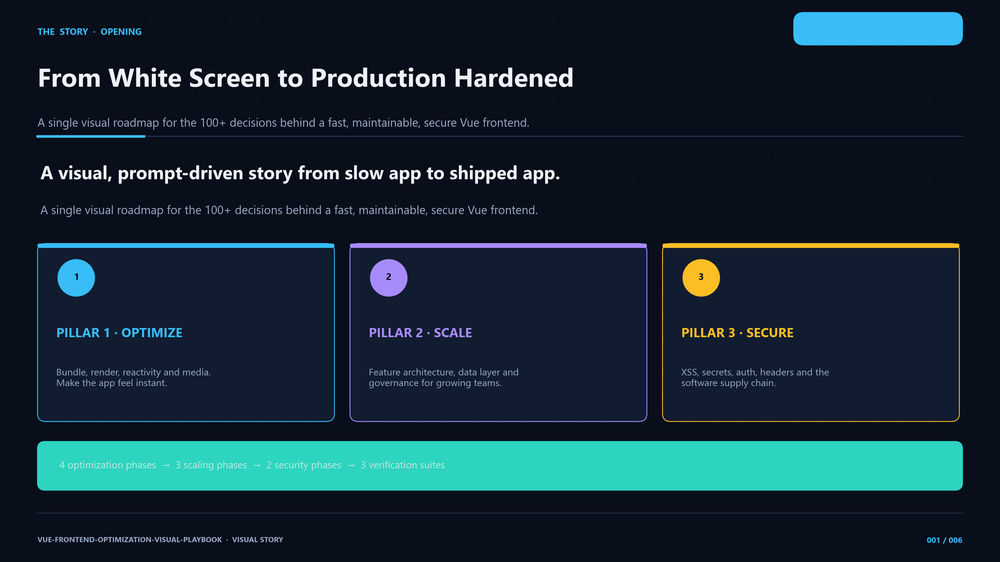

---

## The story in one paragraph

A user opens your app. The entry bundle is too big, the list renders ten thousand rows, a deep watcher re-fetches on every keystroke, and an image pushes the heading down just as they click. You fix that in four ordered phases: **bundle/build**, **rendering**, **reactivity/events** and **media/architecture**. Then you make the fix survive growth with feature folders, typed services, query caching and CI gates. Finally you close the doors: sanitization, secret hygiene, cookie auth, CSP and dependency audits. Each stage has a test suite; the last page is a one-paragraph executive summary you can hand to anyone.

## Contents

| Chapter | What you get | Visuals |
|---|---|---:|
| [0. The Story — Start Here](#0-the-story--start-here) | A single visual roadmap for the 100+ decisions behind a fast, maintainable, secure Vue frontend. | [6](images/00-the-story/01-the-journey.png) |
| [1. Foundations — 50 Mental Models](#1-foundations--50-mental-models) | A view renders, a composable decides, a service fetches. When those jobs stay apart, each can change alone. | [50](images/01-foundations/01-separation-of-concerns.png) |
| [2.1 Optimization Phase 1 — Bundle, Build & Route Splitting](#21-optimization-phase-1--bundle-build--route-splitting) | Seven levers decide how many bytes arrive and how much JavaScript the browser must parse before first paint. | [11](images/02-optimization/phase-1-bundle/01-phase-1-overview.png) |
| [2.2 Optimization Phase 2 — Heavy Component & List Rendering](#22-optimization-phase-2--heavy-component--list-rendering) | Five levers keep the DOM small and the renderer idle: async components, KeepAlive, virtualization, v-once and v-memo. | [15](images/02-optimization/phase-2-rendering/01-phase-2-overview.png) |
| [2.3 Optimization Phase 3 — Reactivity & Events](#23-optimization-phase-3--reactivity--events) | Five changes reduce how often code runs: shallow reactivity, computed caching, targeted watchers, debounce and throttle. | [13](images/02-optimization/phase-3-reactivity/01-phase-3-overview.png) |
| [2.4 Optimization Phase 4 — Media & Rendering Architecture](#24-optimization-phase-4--media--rendering-architecture) | Images usually dominate payload, while SSR/SSG decisions dominate First Contentful Paint and SEO. | [11](images/02-optimization/phase-4-media-ssr/01-phase-4-overview.png) |
| [3.1 Scaling Phase 1 — Architecture & State](#31-scaling-phase-1--architecture--state) | Feature folders, composables, small stores and strict types turn one big app into independent, testable domains. | [7](images/03-scaling/phase-1-architecture/01-scaling-phase-1-overview.png) |
| [3.2 Scaling Phase 2 — Data Layer & Resilience](#32-scaling-phase-2--data-layer--resilience) | Typed services, query caching, workers and error boundaries make the app resilient under real network and data loads. | [8](images/03-scaling/phase-2-data-layer/01-scaling-phase-2-overview.png) |
| [3.3 Scaling Phase 3 — Governance & Delivery](#33-scaling-phase-3--governance--delivery) | Design tokens, RBAC, budgets, CI checks and observability turn good intentions into automated guardrails. | [7](images/03-scaling/phase-3-governance/01-scaling-phase-3-overview.png) |
| [4.1 Security Phase 1 — XSS, Injection & Storage](#41-security-phase-1--xss-injection--storage) | Sanitize at render boundaries, validate at input boundaries, and keep sensitive values out of the browser entirely. | [8](images/04-security/phase-1-xss-storage/01-security-phase-1-overview.png) |
| [4.2 Security Phase 2 — Auth, Headers & Supply Chain](#42-security-phase-2--auth-headers--supply-chain) | Cookies, CSRF, RBAC, CSP and transport headers work together: no single one is sufficient. | [12](images/04-security/phase-2-auth-headers/01-security-phase-2-overview.png) |
| [5. Proof & Ship — Verification Gates](#5-proof--ship--verification-gates) | Prove that routes are lazy, heavy components load asynchronously, caching works and the production build is clean. | [6](images/05-proof-and-ship/01-frontend-opt-tests.png) |
| [Prompt Library](#prompt-library) | Nine phase prompts plus the pipeline master prompt | — |
| [Verification Gates](#verification-gates) | The three test suites and the final summary | — |

## How to read it

- **Skim:** open the images in `images/`; each is a self-contained explanation.
- **Study:** follow the chapters in order; every diagram has an idea, a takeaway and a prompt.
- **Ship:** run one skill per agent session, `/clear` between phases, commit between phases.
- **Verify:** a stage is done only when its named test suite is green.
- **Share:** link a single PNG in a post — a picture of a real bottleneck gets engineers talking.

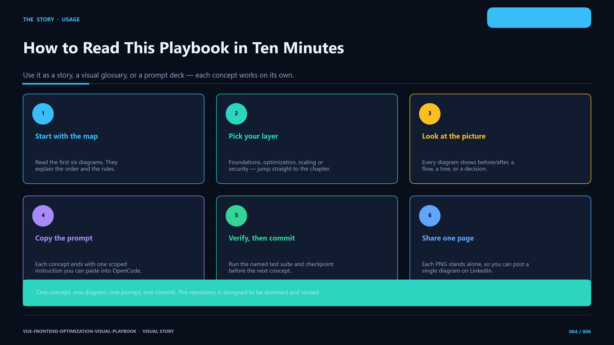

## Regenerating the visuals

```bash
python -m pip install matplotlib pillow
python scripts/validate.py      # check concept payload shapes
python scripts/qa.py            # check clipped text and collisions
python scripts/generate.py      # render all 154 PNGs + images/manifest.json
python scripts/build_readme.py  # rebuild this file
```

Every diagram is 2720×1530 px. The design system lives in `scripts/design.py`; the concept catalogue lives in `scripts/data_*.py`. Change a concept once and both the image and this README update.

---

## Prompt Library

**Do not paste all nine prompts at once.** That forces one giant file read, burns tokens and produces rushed edits. Run one skill per session, clear context, then commit. Pin exact paths (`@src/views/Dashboard.vue`) in large repos and never read `node_modules/`, `dist/`, `.git/` or lockfiles.

### Skill 1 · 1-opt-1-bundle — Optimization phase 1

```text
Analyze package.json, vite.config.*, index.html, and the router configuration (src/router/*). Do not scan unrelated component files yet.

Convert static route imports to dynamic import() lazy-loaded routes for code splitting.

Configure Vite (vite.config.*) for optimal manual chunk splitting, tree-shaking, CSS purging/minification, and Brotli/Gzip compression (vite-plugin-compression), plus add rollup-plugin-visualizer for bundle analysis.

Add critical font/asset <link rel="preload"> hints in index.html.

Apply these changes directly and summarize the updated files.
```

### Skill 2 · 1-opt-2-rendering — Optimization phase 2

```text
Identify the heaviest UI views, modals, and large list/table components in src/views and src/components (skip small UI primitives like buttons/inputs).

Wrap heavy conditional components (modals, charts, drawers) with defineAsyncComponent.

Wrap dynamic tab/route views that benefit from state preservation in <KeepAlive> with an explicit max prop.

Replace large rendered lists (100+ items) with virtual scrolling, and apply v-once on static blocks or v-memo on expensive list items where appropriate.

List the files you modified and why.
```

### Skill 3 · 1-opt-3-reactivity — Optimization phase 3

```text
Audit Vue <script setup> blocks and Pinia stores (src/stores/*) specifically for reactivity and event bottlenecks.

Replace ref/reactive with shallowRef/shallowReactive for large read-only datasets or third-party instances.

Convert expensive template function calls into cached computed properties.

Replace any watch(..., { deep: true }) with targeted property watchers.

Add debouncing or throttling to rapid search inputs, resize, or scroll handlers.

Make minimal, safe edits and list each optimized file.
```

### Skill 4 · 1-opt-4-media-ssr — Optimization phase 4

```text
Scan templates and public/ / src/assets/ for image usage and check if this project requires SSR/SSG.

Add loading="lazy", decoding="async", and explicit width/height attributes to below-the-fold  tags, and update image pipelines/references to prefer WebP/AVIF formats.

Based on our current setup, briefly advise whether migrating to Nuxt (SSR/SSG) or keeping Vite SPA with prerendering (vite-plugin-ssr / vite-ssg) makes sense for SEO and First Contentful Paint—do not migrate frameworks automatically.

Apply safe image attribute changes and end with 3–4 bullets of architectural advice.
```

### Skill 5 · 2-scale-1-architecture — Scaling phase 1

```text
Inspect only src/* directory layout, tsconfig*.json, src/stores/*, and .vue files over 300 lines.

Group tightly coupled views, components, composables and types into src/features/<domain>/ folders following Feature-Sliced Design. Expose each feature through a public index.ts.

Extract reusable stateful logic from large .vue files into use<Feature>.ts composables.

Split monolithic Pinia stores into small Setup Stores with single responsibility.

Enable "strict": true in tsconfig*.json and resolve high-priority implicit any errors. Summarize each moved file.
```

### Skill 6 · 2-scale-2-data-layer — Scaling phase 2

```text
Inspect only src/api/*, src/services/*, components making fetch/axios calls, heavy data utilities, and top-level layouts.

Centralize raw fetch/axios calls into typed domain service modules (src/services/<domain>.service.ts) with shared interceptors.

Introduce TanStack Query (@tanstack/vue-query) for server-state endpoints needing caching, deduplication and background refetching.

Offload heavy parsing/filtering to a dedicated Vite Web Worker.

Wrap major feature views in reusable error boundaries using onErrorCaptured so one widget cannot blank the app. List every changed file.
```

### Skill 7 · 2-scale-3-governance — Scaling phase 3

```text
Inspect only src/components/ui/*, CSS theme files, src/router/*, src/main.ts, vite.config.*, and .github/workflows/*.

Consolidate hardcoded colors, spacing and typography into CSS custom property design tokens and standardize base UI props/slots.

Refactor route meta and router.beforeEach into declarative role/permission (RBAC) checks.

Set build.chunkSizeWarningLimit and ensure CI runs vue-tsc, Vitest and Playwright.

Add app.config.errorHandler / Sentry readiness in src/main.ts and briefly evaluate whether Module Federation is justified by our team size. Do not adopt it automatically.
```

### Skill 8 · 3-sec-1-xss-storage — Security phase 1

```text
Inspect only templates with v-html or dynamic :href/:src, form components, .env* files, localStorage/sessionStorage usage and logging utilities.

Wrap every untrusted v-html binding in DOMPurify.sanitize(...) with an explicit allowlist and block javascript: URIs in dynamic :href bindings.

Enforce strict schema validation (Zod or vee-validate) on all user input forms.

Inspect .env* and import.meta.env.VITE_* references to ensure zero private API secrets, database keys or signing tokens leak into the client bundle.

Remove raw JWTs, passwords and PII from localStorage/sessionStorage and strip sensitive payload dumps from console.log and error trackers.
```

### Skill 9 · 3-sec-2-auth-headers — Security phase 2

```text
Inspect only auth stores/services, HTTP interceptors, src/router/*, index.html, hosting configs and package.json.

Configure HTTP clients with withCredentials: true for HttpOnly; Secure; SameSite cookie auth, attach CSRF token headers on state-mutating requests, and handle 401 refresh-token rotation safely without infinite retry loops.

Verify router.beforeEach blocks unauthenticated or unauthorized navigation before component mounting—never rely on v-if hiding alone.

Add Content Security Policy, frame-ancestors 'none' / X-Frame-Options: DENY, and HSTS headers in hosting configs, plus Subresource Integrity hashes on external CDN tags.

Add client-side submit throttling/CAPTCHA hooks on auth forms and run npm audit --audit-level=high, reporting any advisories.
```

### Production hardening pipeline — master prompt

```text
You are executing a complete post-development Production Hardening Pipeline across three pillars in strict sequential order:

1. Frontend Optimization (verified in /frontend-opt-tests)
2. Architecture & Data Scaling (verified in /scaling-tests)
3. Application Security Hardening (verified in /security-tests)

Context rules:
- Work sequentially stage-by-stage. Never dump entire large files into responses—output concise diffs, summaries and test pass/fail results.
- Never read node_modules/, dist/, .git/ or lockfiles.
- Use installed libraries where present. Install missing lightweight utilities only if required.
- Run the verification tests after EACH stage and fix regressions before moving to the next stage.

Start with Stage 1 only: /frontend-opt-tests. Do not touch scaling or security files yet.
```

Token-saving rules: clear context between prompts, scope every read to named folders, commit after each phase so a shallowRef or v-memo regression is one `git revert` away, and audit bundle size plus Lighthouse after each stage rather than at the end.

---

## <a id="0-the-story--start-here"></a>0. The Story — Start Here

Every diagram in this repository is one page of the same story: a slow Vue app becomes a fast one, then a scalable one, then a safe one — and every step is verified before the next begins.

### 01 · From White Screen to Production Hardened


**The idea.** A single visual roadmap for the 100+ decisions behind a fast, maintainable, secure Vue frontend.

**Why it matters.** Speed is a system property. The three pillars are ordered: optimize what users feel first, then structure the code that keeps it fast, then close the doors that attackers use.

**Prompt.**

```text
Read the story top to bottom. Each concept has one diagram, one plain-English takeaway and one copy-paste prompt.
```

### 02 · Speed Is a Feature Users Feel Before They Measure

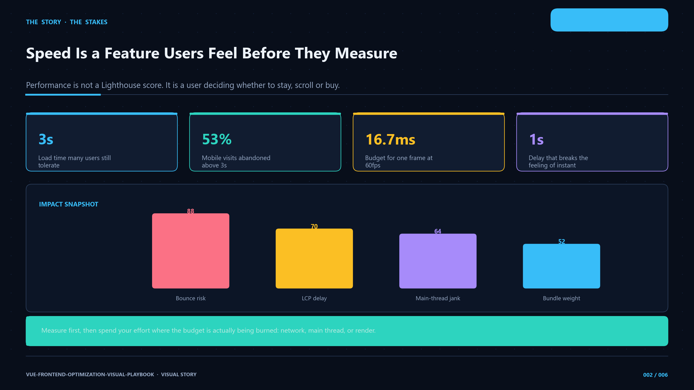

**The idea.** Performance is not a Lighthouse score. It is a user deciding whether to stay, scroll or buy.

**Why it matters.** A slow app loses attention before it loses arguments. Every optimization in this guide attacks one of four costs: bytes over the wire, JavaScript on the main thread, DOM work per render, or uncertainty in the UI.

**Prompt.**

```text
Before changing code, open DevTools Network + Performance and name the bottleneck out loud. Never optimize by vibes.
```

### 03 · The Pipeline: Optimize, Scale, Secure, Verify

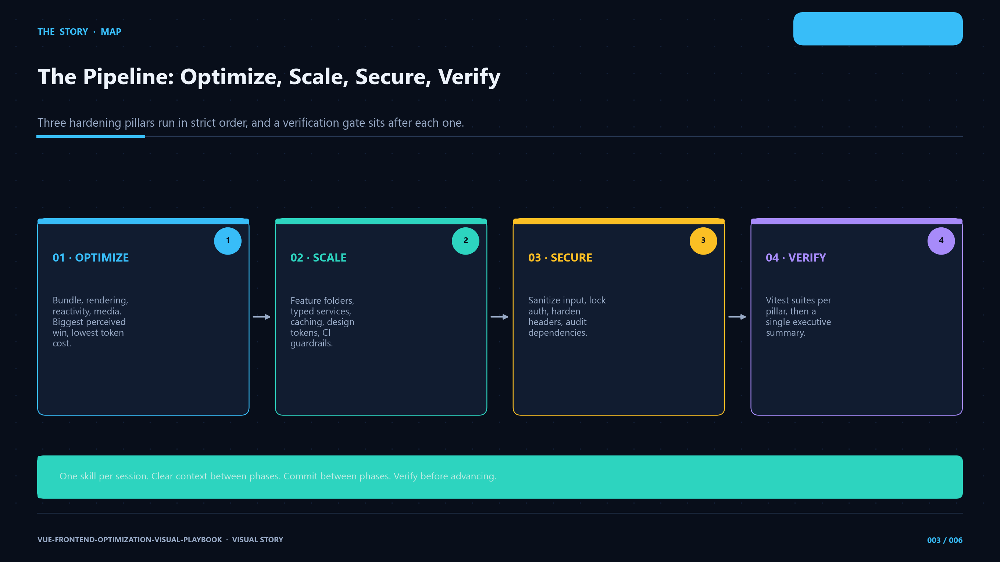

**The idea.** Three hardening pillars run in strict order, and a verification gate sits after each one.

**Why it matters.** The order is deliberate: architecture changes can invalidate performance work, and security work can break auth flows. Sequential stages with tests between them make regressions visible instead of mysterious.

**Prompt.**

```text
Follow /frontend-opt-tests → /scaling-tests → /security-tests. Do not start stage N+1 while stage N has a red test.
```

### 04 · How to Read This Playbook in Ten Minutes


**The idea.** Use it as a story, a visual glossary, or a prompt deck — each concept works on its own.

**Why it matters.** A guide that cannot be scanned will not be used. The images are the table of contents; the prompts are the action; the tests are the proof.

**Prompt.**

```text
Bookmark the chapter you are working on today and open the matching prompt from the Prompt Library section.
```

### 05 · The Loop That Makes Optimization Repeatable

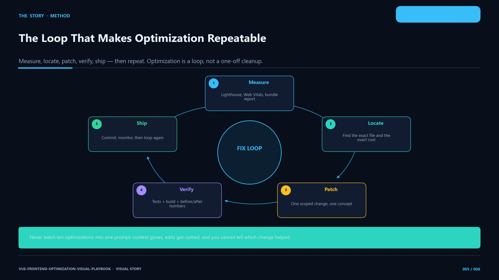

**The idea.** Measure, locate, patch, verify, ship — then repeat. Optimization is a loop, not a one-off cleanup.

**Why it matters.** A loop with one change per iteration gives you attribution: you know which edit moved LCP, which one broke reactivity, and which one to revert.

**Prompt.**

```text
For every change, write the before number and the after number in the commit message. If you cannot measure it, call it a refactor, not a performance fix.
```

### 06 · One Skill Per Session: The Token Budget Is Real

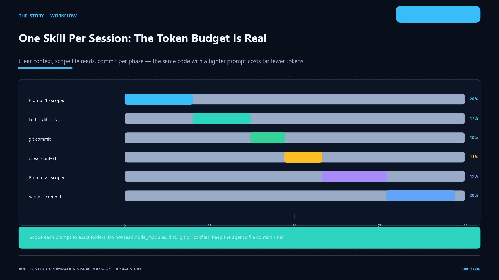

**The idea.** Clear context, scope file reads, commit per phase — the same code with a tighter prompt costs far fewer tokens.

**Why it matters.** Large contexts are slow and expensive. The guide's four-phase prompt split exists because focused prompts produce better edits, cleaner checkpoints and lower token bills.

**Prompt.**

```text
Run /clear between phases, pin exact paths with @src/views/Dashboard.vue, and commit after every phase.
```

---

## <a id="1-foundations--50-mental-models"></a>1. Foundations — 50 Mental Models

Fifty mental models sit underneath every optimization. Learn these once and each later phase becomes an application of the same few rules: one owner for state, one direction for data, one reason for each component to change.

### 01 · Separation of Concerns


**The idea.** A view renders, a composable decides, a service fetches. When those jobs stay apart, each can change alone.

**Why it matters.** Mixed concerns make every edit risky. Splitting by job, not by file type, is the first move in every refactor.

**Prompt.**

```text
Split this component into a presentational view, one use<Feature> composable and one typed service call.
```

### 02 · Single Source of Truth

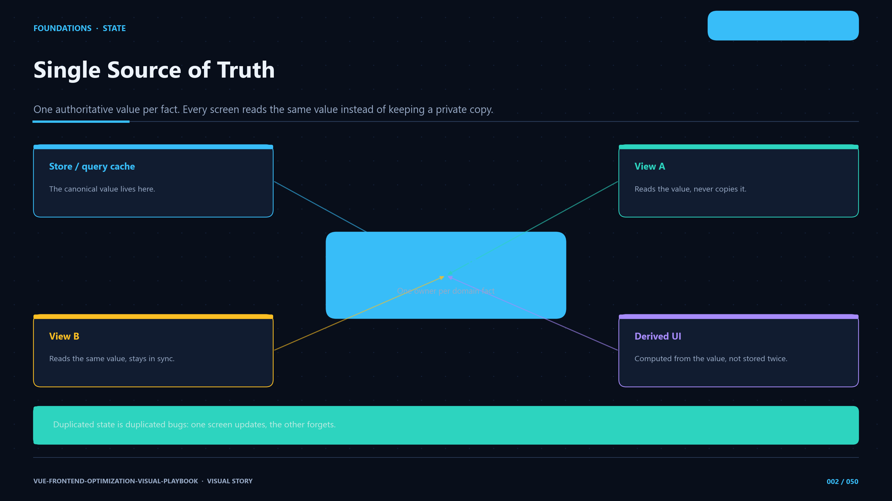

**The idea.** One authoritative value per fact. Every screen reads the same value instead of keeping a private copy.

**Why it matters.** Copying server data into local state creates drift. Read the canonical store and derive everything else.

**Prompt.**

```text
Find local copies of server data in this component and replace each with a store getter or query result.
```

### 03 · Unidirectional Data Flow


**The idea.** State flows down as props, events flow up as intent. The direction never reverses.

**Why it matters.** Two-way mutation across sibling components hides causality. Events up, state down keeps every change explainable.

**Prompt.**

```text
Replace this child's direct state mutation with an emit to its parent and one store action.
```

### 04 · Prop Drilling


**The idea.** Passing a value through five components that do not use it adds noise and coupling at every hop.

**Why it matters.** Drilling is not always wrong — one level is explicit and cheap. It becomes a smell when pass-through props outnumber real props.

**Prompt.**

```text
Replace this 3+ level prop chain with provide/inject scoped to the feature or a store getter.
```

### 05 · State Mutation


**The idea.** Mutating shared state in place hides the moment of change. Replace the object so the change is visible and traceable.

**Why it matters.** In-place mutation breaks shallow reactivity and memoization because nothing detects a new identity.

**Prompt.**

```text
Convert this nested mutation into a single immutable reassignment of the top-level value.
```

### 06 · Derived State


**The idea.** If a value can be computed from existing state, do not store it. Derive it and let caching do the work.

**Why it matters.** Derived state stored in a ref needs a watcher to stay correct. computed() makes correctness structural.

**Prompt.**

```text
Replace this ref + watcher pair with computed() and delete the synchronized copy.
```

### 07 · Reactive Coupling


**The idea.** When one render touches unrelated reactive values, every unrelated change re-renders it. Narrow the dependency.

**Why it matters.** Reactivity is a dependency graph. The bigger the graph each component subscribes to, the more work every update causes.

**Prompt.**

```text
Split this shared reactive object into focused refs and read only the field each component needs.
```

### 08 · Side Effects

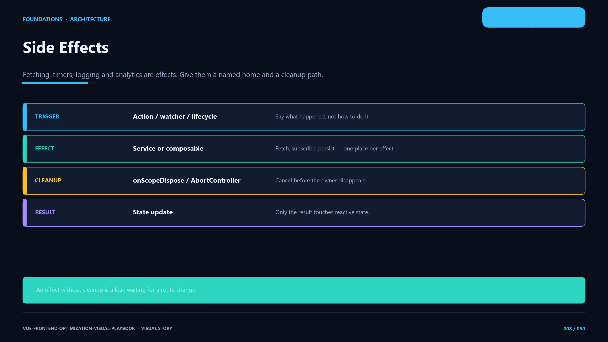

**The idea.** Fetching, timers, logging and analytics are effects. Give them a named home and a cleanup path.

**Why it matters.** Effects scattered in templates and computed getters run unpredictably and are hard to cancel.

**Prompt.**

```text
Move this effect into the composable, attach onScopeDispose, and return a cancel function.
```

### 09 · Composable Extraction


**The idea.** When a component mixes state, Effects and markup, extract the behaviour into use<Feature>() and leave the view declarative.

**Why it matters.** Composables are the Vue unit of reusable stateful logic. They keep business rules out of templates and out of global stores.

**Prompt.**

```text
Extract this component's fetch + filter + reset logic into use<Feature>.ts and keep only bindings in the view.
```

### 10 · Reactivity Leaks


**The idea.** A proxy nested inside a plain wrapper can silently lose reactivity — or keep tracking long after it is needed.

**Why it matters.** Deep reactivity is convenient for small objects and expensive for large ones. Leaks also happen when tracking outlives the component.

**Prompt.**

```text
Audit this file for reactive() around third-party instances and narrow it with shallowRef or markRaw.
```

### 11 · Watcher Abuse

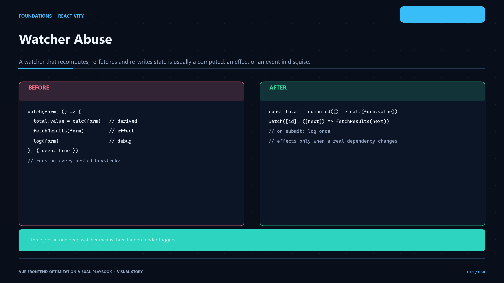

**The idea.** A watcher that recomputes, re-fetches and re-writes state is usually a computed, an effect or an event in disguise.

**Why it matters.** Watchers are for crossing boundaries: state → network, state → storage. Use computed for values.

**Prompt.**

```text
Replace this watcher: move derived work to computed, narrow dependencies, and keep only the side effect.
```

### 12 · Memory Leaks

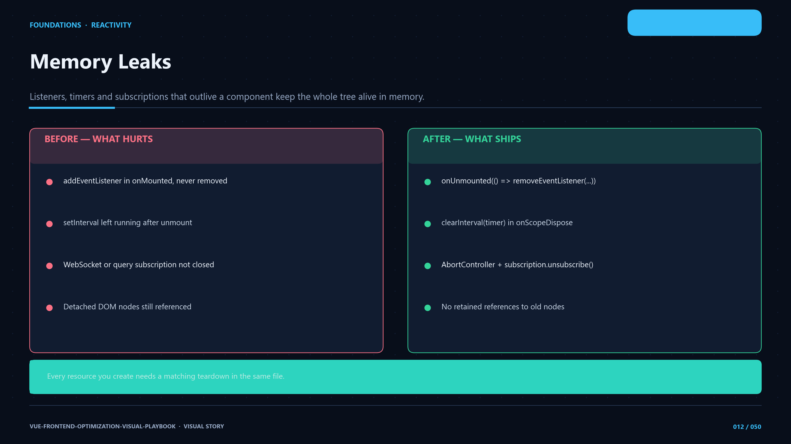

**The idea.** Listeners, timers and subscriptions that outlive a component keep the whole tree alive in memory.

**Why it matters.** Leaks are invisible in development and fatal after a hundred route changes. Cleanup is part of the feature, not an afterthought.

**Prompt.**

```text
Add teardown for every listener/timer/subscription created in this component and verify with the heap profiler.
```

### 13 · Template Bloat


**The idea.** Thousands of nodes and inline expressions make the renderer do work on every update.

**Why it matters.** Vue's renderer is fast, but it still walks every node. Shrink the tree first, then optimize the diff.

**Prompt.**

```text
Virtualize this list and move the inline formatting calls into a computed map before touching reactivity.
```

### 14 · Type Safety


**The idea.** Types move whole classes of bugs from runtime to editor time — especially at API and prop boundaries.

**Why it matters.** Type safety is not ceremony; it is the cheapest regression test you run on every keystroke.

**Prompt.**

```text
Type this component's props and its service response, then run vue-tsc and fix the reported errors.
```

### 15 · God Component


**The idea.** One component that fetches, decides, formats and renders every state becomes impossible to reason about or reuse.

**Why it matters.** Large components concentrate coupling. The goal is not tiny files for their own sake but small reasons to change.

**Prompt.**

```text
List the reasons this component changes and split it along those boundaries into child views and composables.
```

### 16 · Presentational Components

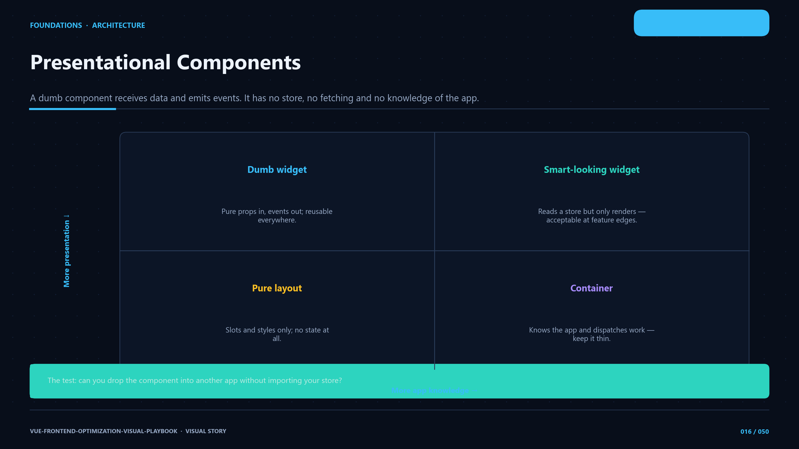

**The idea.** A dumb component receives data and emits events. It has no store, no fetching and no knowledge of the app.

**Why it matters.** Presentational components are easy to test, storybook and reuse because they have no hidden dependencies.

**Prompt.**

```text
Remove store imports from this widget and pass the required data and callbacks as props/emits instead.
```

### 17 · Container Components

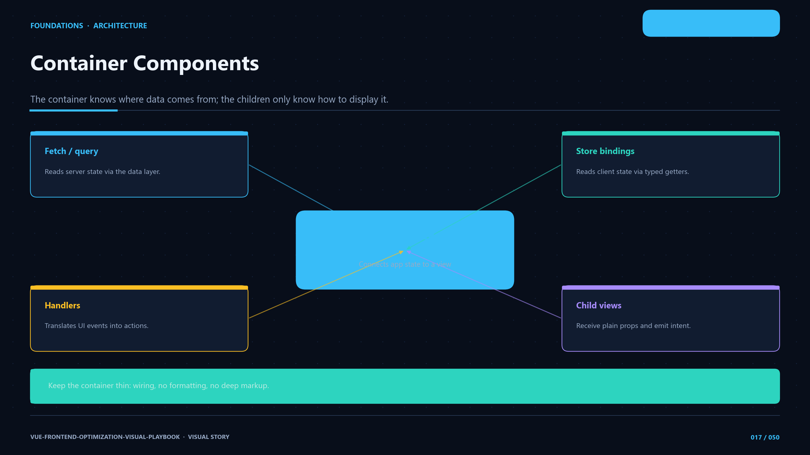

**The idea.** The container knows where data comes from; the children only know how to display it.

**Why it matters.** The container/presentational split localizes app knowledge so the expensive UI tests can stay shallow.

**Prompt.**

```text
Move this page's store reads and fetch calls into a container and leave the markup in a props-only child.
```

### 18 · High Cohesion

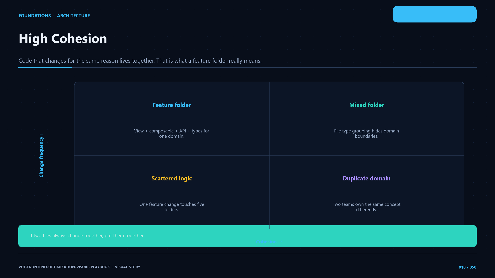

**The idea.** Code that changes for the same reason lives together. That is what a feature folder really means.

**Why it matters.** Cohesion reduces merge conflicts and makes ownership obvious because one domain is one place.

**Prompt.**

```text
Move this feature's view, composable, API module and types into src/features/<domain>/.
```

### 19 · Low Coupling


**The idea.** Components should depend on narrow interfaces, not on each other's internals.

**Why it matters.** Low coupling is what makes parallel work possible: teams can change their own code without coordinating every edit.

**Prompt.**

```text
Replace this component's import of a sibling's internals with a typed service call or emitted event.
```

### 20 · Composition over Inheritance


**The idea.** Vue components compose through slots and props. Deep component inheritance creates fragile, hidden behaviour.

**Why it matters.** Composition makes data flow visible. Inheritance hides it in a chain you have to reconstruct mentally.

**Prompt.**

```text
Replace this component inheritance with a wrapper component using slots plus a shared composable.
```

### 21 · Immutability


**The idea.** Treat state snapshots as values. A new reference means something changed; the same reference means nothing did.

**Why it matters.** Immutability is the contract that makes memoization, shallow reactivity and time-travel debugging work.

**Prompt.**

```text
Rewrite this state change as a top-level reassignment and verify the memoized child still updates.
```

### 22 · Dependency Injection

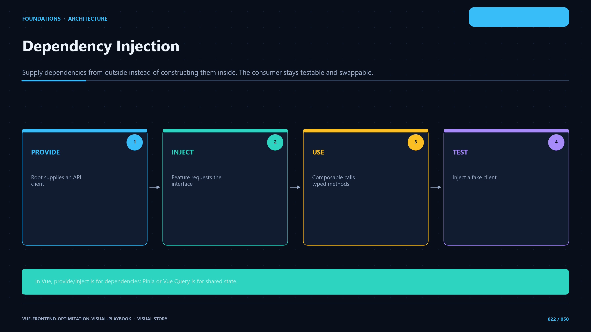

**The idea.** Supply dependencies from outside instead of constructing them inside. The consumer stays testable and swappable.

**Why it matters.** Hard-coded imports bind a component to one implementation. Injection lets tests replace it without mocking modules.

**Prompt.**

```text
Provide this API client at the feature root and inject it into the composable instead of importing it directly.
```

### 23 · Inversion of Control


**The idea.** Frameworks call your code. Let Vue own the lifecycle and keep your logic in hooks it can schedule and tear down.

**Why it matters.** Fighting the scheduler produces double renders and race conditions. Hooks are the contract for when code runs.

**Prompt.**

```text
Replace this manual DOM polling with a watcher/computed and move cleanup into onScopeDispose.
```

### 24 · Event-Driven Architecture

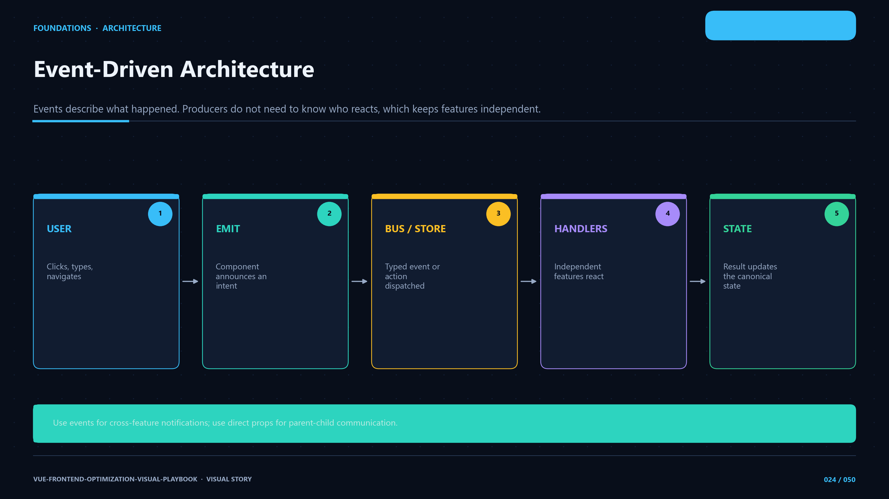

**The idea.** Events describe what happened. Producers do not need to know who reacts, which keeps features independent.

**Why it matters.** Events decouple producers from consumers, but untyped global buses become invisible spaghetti. Keep the contract typed.

**Prompt.**

```text
Replace this cross-feature callback chain with a typed event or store action and document its consumers.
```

### 25 · State Machines


**The idea.** Model UI as explicit states and allowed transitions. Impossible states become unrepresentable.

**Why it matters.** Explicit states remove the impossible combinations that cause blank screens and double submissions.

**Prompt.**

```text
Replace these booleans with a discriminated union status and render one branch per state.
```

### 26 · Optimistic UI

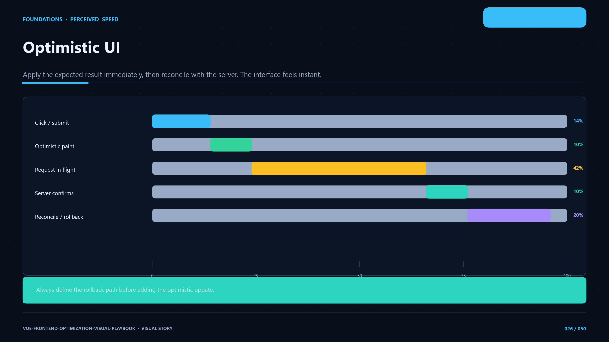

**The idea.** Apply the expected result immediately, then reconcile with the server. The interface feels instant.

**Why it matters.** Optimistic UI trades a moment of uncertainty for a much faster feel. It is only safe when failures are handled visibly.

**Prompt.**

```text
Apply this mutation optimistically, keep the previous snapshot, and roll back with a clear message on failure.
```

### 27 · Race Conditions

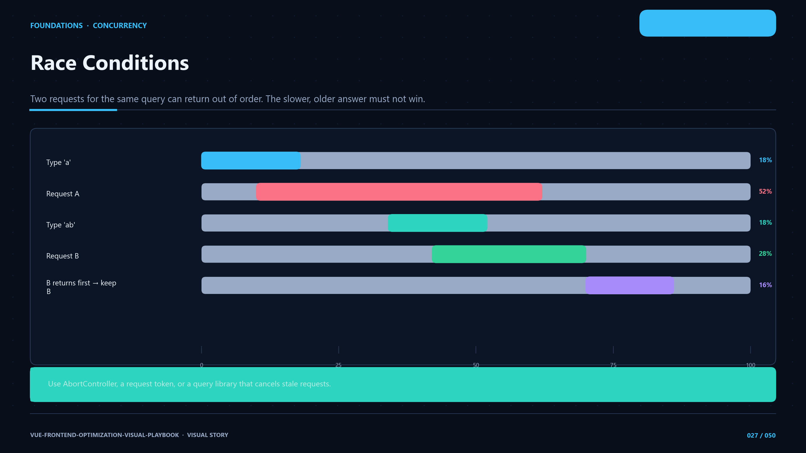

**The idea.** Two requests for the same query can return out of order. The slower, older answer must not win.

**Why it matters.** Async results arriving in the wrong order is the classic source of stale search results and flickering UI.

**Prompt.**

```text
Abort the previous request in this watcher or tag each response with a token and ignore stale results.
```

### 28 · Idempotency


**The idea.** Repeating the same operation must produce the same result. Retries then become safe instead of dangerous.

**Why it matters.** Anything that can be retried will be retried. Design the mutation so the second attempt is harmless.

**Prompt.**

```text
Attach an idempotency key to this mutation and disable the submit control while the request is pending.
```

### 29 · Caching Strategy


**The idea.** Every piece of data needs an owner and a lifetime: server cache, client store, or no cache at all.

**Why it matters.** Cache policy is a design decision, not a library default. Wrong layers cause stale screens or needless requests.

**Prompt.**

```text
Classify this data as server or client state, assign one cache owner, and document its staleness window.
```

### 30 · Stale-While-Revalidate


**The idea.** Show cached data instantly, refresh it quietly in the background, then replace it when the new answer arrives.

**Why it matters.** SWR improves perceived speed without sacrificing freshness, because the refresh happens after paint.

**Prompt.**

```text
Configure this query to return cached data immediately and refetch on mount and focus.
```

### 31 · Code Splitting


**The idea.** Ship the code for the current screen, not the whole app. Smaller entry chunks mean faster first paint.

**Why it matters.** The browser must download, parse and execute everything you send. The cheapest byte is the one you never ship.

**Prompt.**

```text
Convert this route or heavy feature to a dynamic import and inspect the new chunk graph.
```

### 32 · Lazy Loading


**The idea.** Defer a module until the user is likely to need it. Loading is a scheduling decision.

**Why it matters.** Lazy loading without a fallback feels broken. Always render a placeholder that occupies the final space.

**Prompt.**

```text
Wrap this heavy view in defineAsyncComponent with a skeleton loadingComponent and an errorComponent.
```

### 33 · Tree Shaking


**The idea.** The bundler drops exports nothing imports. Write code that can be dropped — keep side effects explicit.

**Why it matters.** Tree shaking works best with static imports, named exports and pure modules. Wildcard imports defeat it.

**Prompt.**

```text
Replace wildcard imports in this file with named imports and confirm the chunk shrinks after build.
```

### 34 · Bundle Bloat

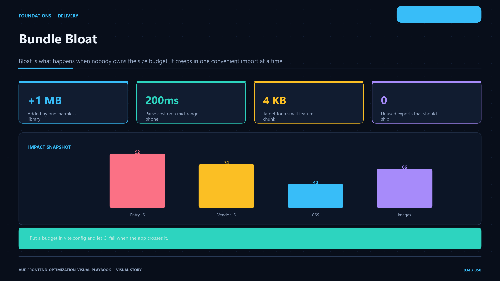

**The idea.** Bloat is what happens when nobody owns the size budget. It creeps in one convenient import at a time.

**Why it matters.** Size is a product constraint like any other. Without a budget, every dependency looks free until the Lighthouse score drops.

**Prompt.**

```text
Run the bundle visualizer, find the largest module, and either lazy-load it or replace it.
```

### 35 · Render Bottlenecks

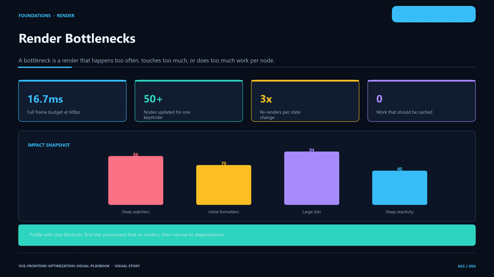

**The idea.** A bottleneck is a render that happens too often, touches too much, or does too much work per node.

**Why it matters.** Render cost is (number of nodes) × (number of renders) × (work per node). Attack whichever factor is largest.

**Prompt.**

```text
Profile this interaction, name the re-rendering component, and apply one of the three fixes before moving on.
```

### 36 · Virtual Scrolling


**The idea.** Render the 20 rows the user can see, not the 10,000 rows the data contains.

**Why it matters.** The DOM is the render bottleneck. Virtual scrolling caps it with a window and spacer elements.

**Prompt.**

```text
Replace this v-for with @tanstack/vue-virtual and keep a fixed row height or measured estimate.
```

### 37 · Debouncing

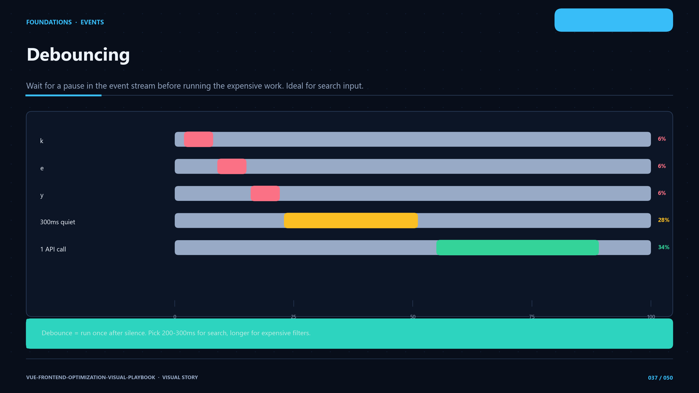

**The idea.** Wait for a pause in the event stream before running the expensive work. Ideal for search input.

**Why it matters.** Typing 'keyboard' should not fire seven requests. Debouncing collapses a burst into one intentional action.

**Prompt.**

```text
Wrap this search handler in useDebounceFn(fn, 300) and cancel it on unmount.
```

### 38 · Throttling

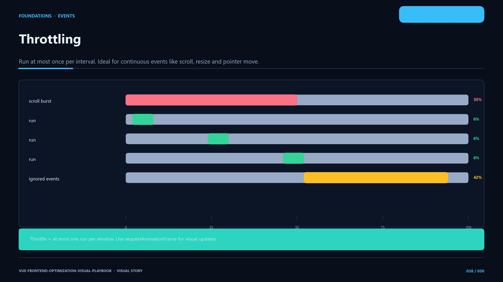

**The idea.** Run at most once per interval. Ideal for continuous events like scroll, resize and pointer move.

**Why it matters.** Throttling keeps feedback responsive without doing layout work on every native event.

**Prompt.**

```text
Throttle this scroll/resize handler to one call per frame and read layout only inside that callback.
```

### 39 · Error Boundaries

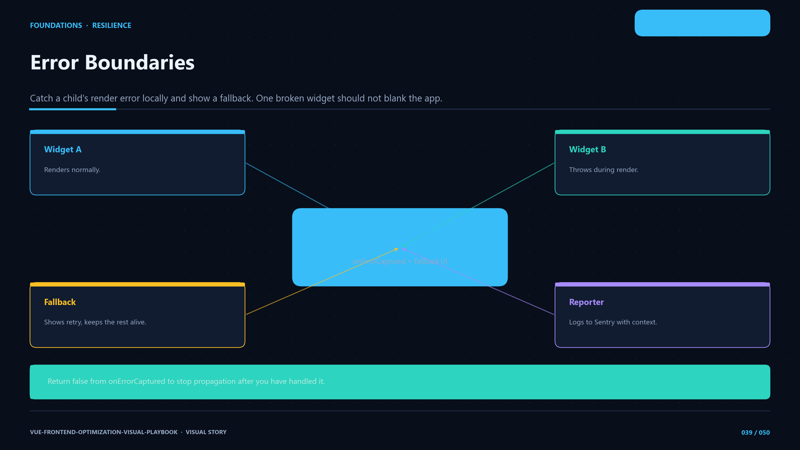

**The idea.** Catch a child's render error locally and show a fallback. One broken widget should not blank the app.

**Why it matters.** Error boundaries turn a total outage into a degraded feature. They belong around independent feature roots.

**Prompt.**

```text
Wrap this feature view in an ErrorBoundary component with a retry button and error reporting hook.
```

### 40 · Graceful Degradation

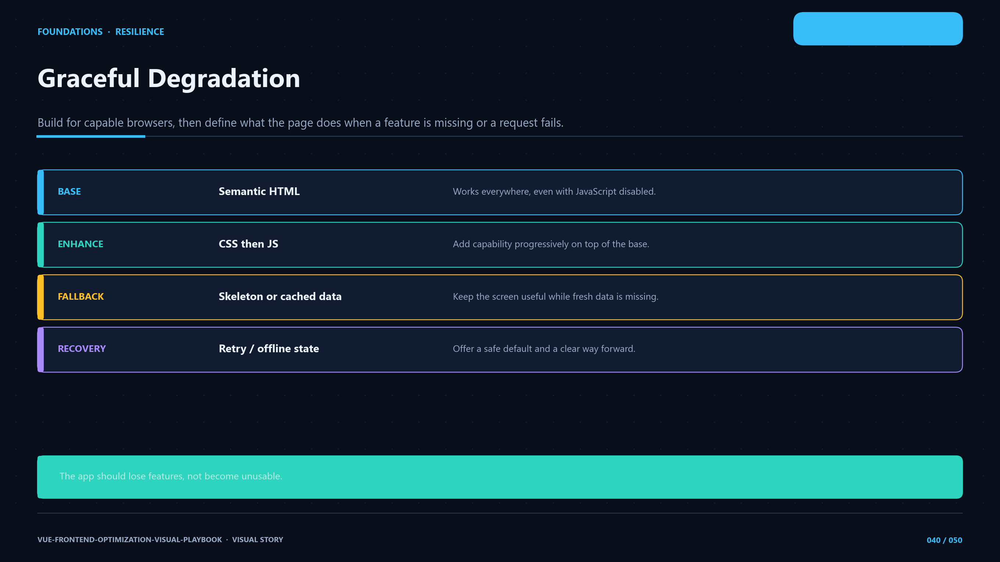

**The idea.** Build for capable browsers, then define what the page does when a feature is missing or a request fails.

**Why it matters.** Degradation is a product decision made in code: what is the minimum useful version of this screen?

**Prompt.**

```text
Define the fallback for this feature when its API fails and render it without blocking the rest of the page.
```

### 41 · Defensive Programming

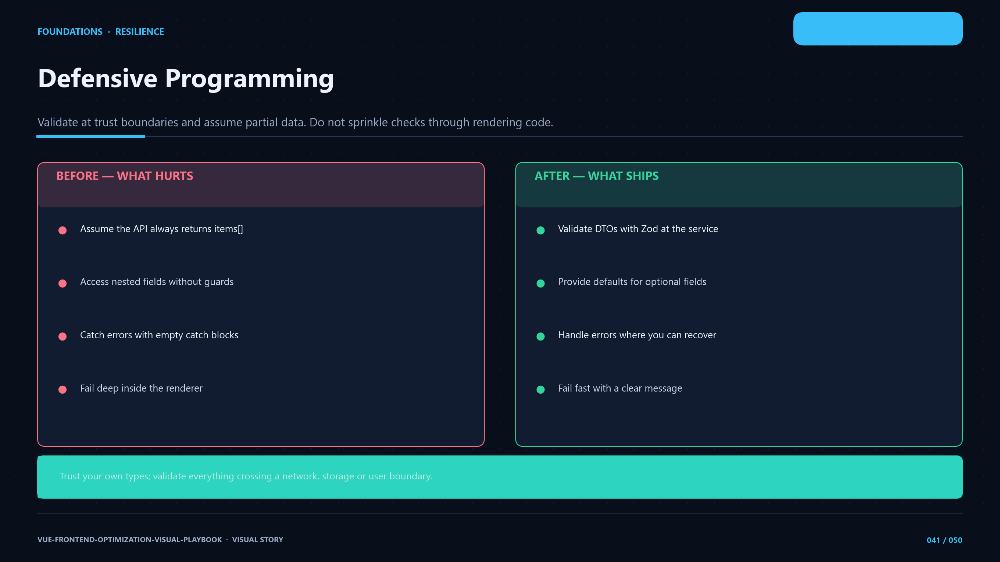

**The idea.** Validate at trust boundaries and assume partial data. Do not sprinkle checks through rendering code.

**Why it matters.** Defensive code belongs at the edges. Inside the system, types and invariants should already hold.

**Prompt.**

```text
Add a Zod schema at this service boundary and give the template a safe default for missing fields.
```

### 42 · Strict Typing

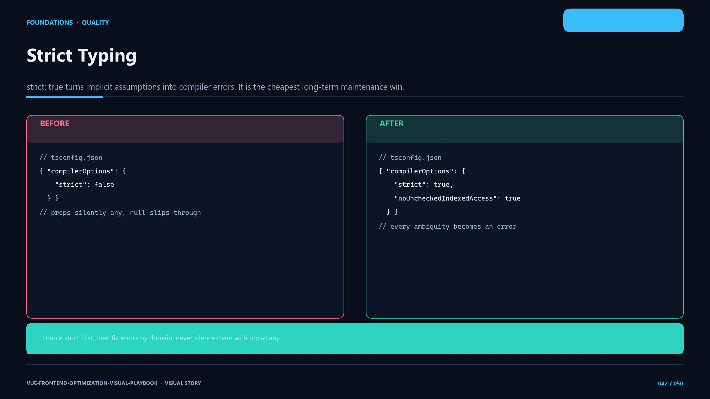

**The idea.** strict: true turns implicit assumptions into compiler errors. It is the cheapest long-term maintenance win.

**Why it matters.** Strict mode pays back on every refactor: the compiler finds the callers you forgot.

**Prompt.**

```text
Enable strict in tsconfig, run vue-tsc, and fix the errors in one domain at a time.
```

### 43 · Interface Segregation

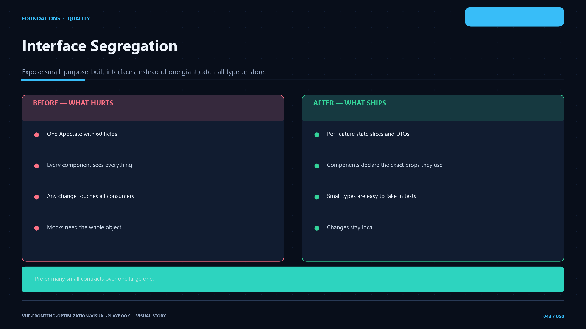

**The idea.** Expose small, purpose-built interfaces instead of one giant catch-all type or store.

**Why it matters.** Large interfaces force components to depend on fields they never use, which increases coupling and test cost.

**Prompt.**

```text
Replace this catch-all type with two narrow interfaces named after their consumers.
```

### 44 · Technical Debt

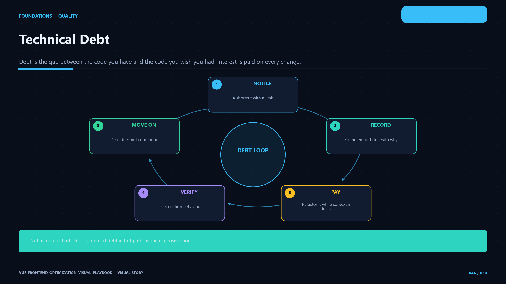

**The idea.** Debt is the gap between the code you have and the code you wish you had. Interest is paid on every change.

**Why it matters.** Debt becomes dangerous when nobody knows it exists. Write the limit down next to the shortcut.

**Prompt.**

```text
Log each shortcut with a one-line limit and upgrade condition, then pay the highest-interest one first.
```

### 45 · Refactoring


**The idea.** Change the structure without changing behaviour. Tests are the safety net that makes this boring.

**Why it matters.** Refactoring is a disciplined loop, not a week-long rewrite. Small steps with green tests keep risk near zero.

**Prompt.**

```text
Add a test around this behaviour, then apply one structural change and re-run it before continuing.
```

### 46 · Modularity

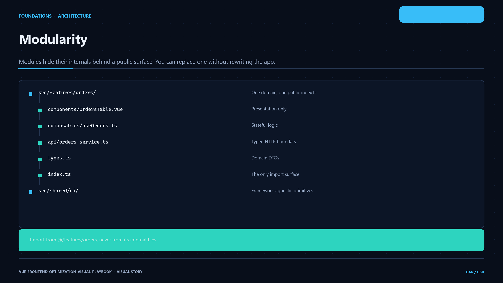

**The idea.** Modules hide their internals behind a public surface. You can replace one without rewriting the app.

**Why it matters.** A public index.ts is a cheap enforceable boundary: it tells you exactly what the rest of the app may use.

**Prompt.**

```text
Add an index.ts to this feature and update imports to use the public surface only.
```

### 47 · Scalability

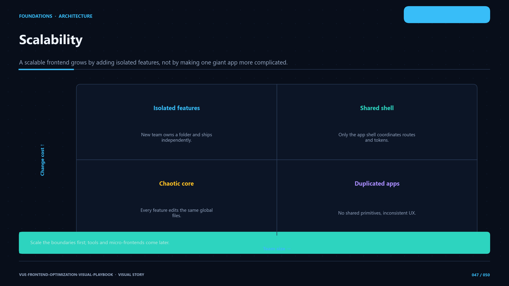

**The idea.** A scalable frontend grows by adding isolated features, not by making one giant app more complicated.

**Why it matters.** Micro-frontends solve organizational problems. Start with module boundaries and shared conventions before adopting them.

**Prompt.**

```text
Draw the ownership boundary for this feature and list the shared contracts it depends on.
```

### 48 · Maintainability

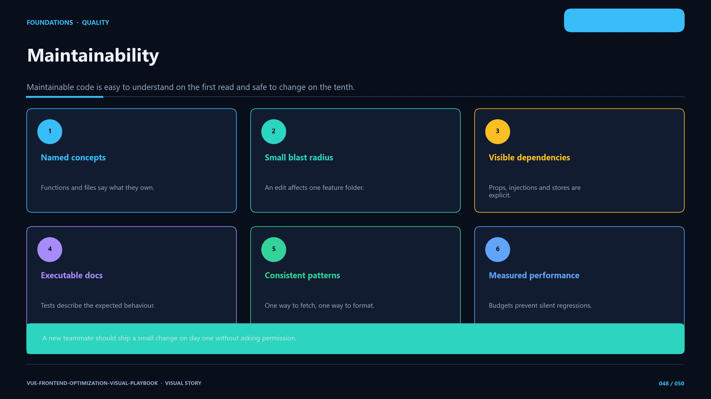

**The idea.** Maintainable code is easy to understand on the first read and safe to change on the tenth.

**Why it matters.** Maintainability is the compound result of the other foundations — not a separate activity at the end.

**Prompt.**

```text
Score this module on these six points and fix the weakest one with a single scoped change.
```

### 49 · Abstraction Layers

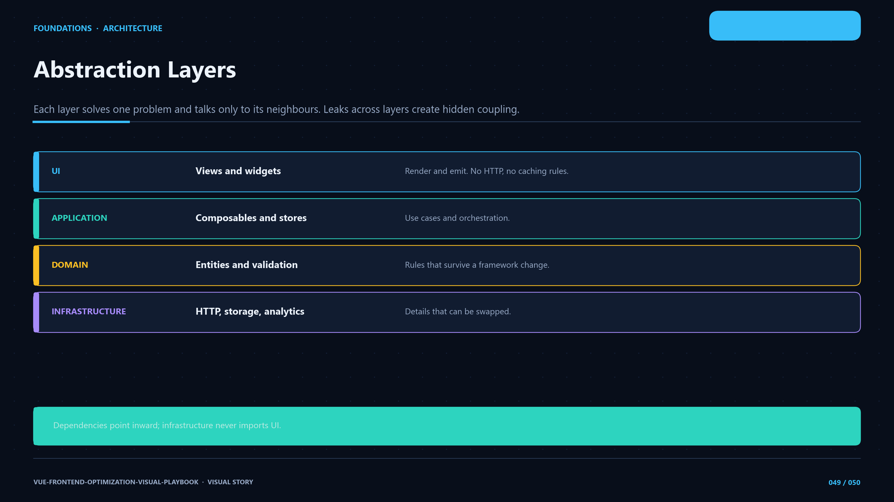

**The idea.** Each layer solves one problem and talks only to its neighbours. Leaks across layers create hidden coupling.

**Why it matters.** Layers are useful only when they are enforced. One leaked import collapses the benefit of all of them.

**Prompt.**

```text
Move this HTTP call out of the view into the service layer and keep only a typed result in the component.
```

### 50 · Lifecycle Management

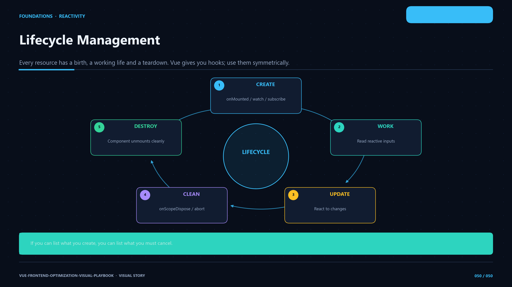

**The idea.** Every resource has a birth, a working life and a teardown. Vue gives you hooks; use them symmetrically.

**Why it matters.** Unmatched lifecycles are the root of timers firing after unmount and subscriptions piling up in long sessions.

**Prompt.**

```text
Audit this component: pair every listener, timer and subscription with a teardown in onScopeDispose.
```

---

## <a id="21-optimization-phase-1--bundle-build--route-splitting"></a>2.1 Optimization Phase 1 — Bundle, Build & Route Splitting

Phase 1 has the biggest impact for the least work. Scope the prompt to package.json, Vite config, index.html and the router — do not read unrelated components yet.

### 01 · Phase 1 Overview: Bundle, Build & Route Splitting


**The idea.** Seven levers decide how many bytes arrive and how much JavaScript the browser must parse before first paint.

**Why it matters.** This phase touches configuration, not business logic. That makes it the safest place to start and easiest to measure.

**Prompt.**

```text
Analyze package.json, vite.config.*, index.html and src/router/* only. Do not scan unrelated component files yet.
```

### 02 · Convert Static Routes to Lazy Routes

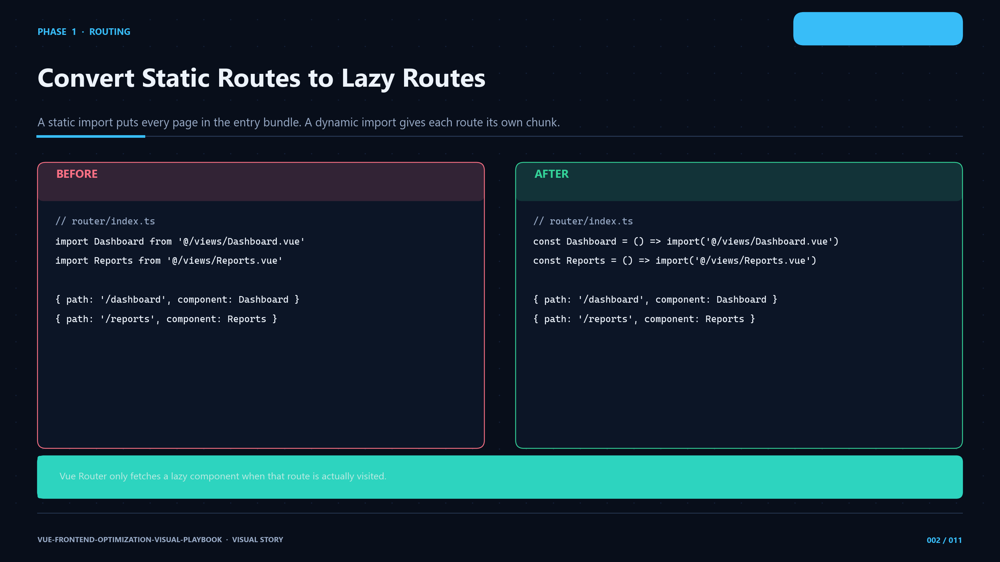

**The idea.** A static import puts every page in the entry bundle. A dynamic import gives each route its own chunk.

**Why it matters.** Route-level splitting is the highest leverage change in most Vue apps: one line per route, immediate payload win.

**Prompt.**

```text
Convert every static route component import in src/router/* to a dynamic () => import(...) import.
```

### 03 · What dynamic import() Actually Returns

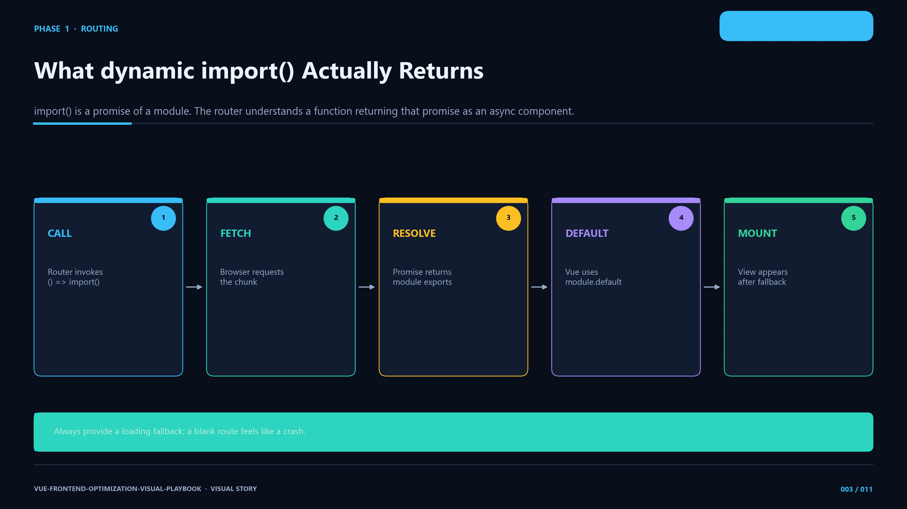

**The idea.** import() is a promise of a module. The router understands a function returning that promise as an async component.

**Why it matters.** Understanding the promise contract explains why typeof route.component === 'function' is the test for lazy routes.

**Prompt.**

```text
Verify each route component is a function, not an imported object, and add a loading fallback for slow networks.
```

### 04 · Vite manualChunks: Split Vendors Deliberately

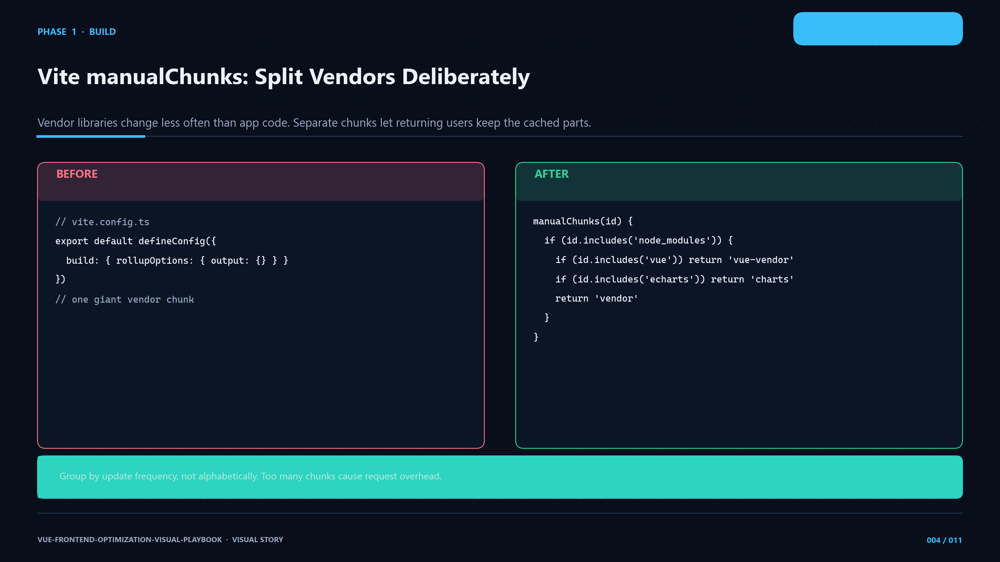

**The idea.** Vendor libraries change less often than app code. Separate chunks let returning users keep the cached parts.

**Why it matters.** Chunking improves caching, not total bytes. Split heavy libraries that change independently of your app code.

**Prompt.**

```text
Configure build.rollupOptions.output.manualChunks in vite.config.* to isolate vue, vue-router, pinia and chart libraries.
```

### 05 · Tree-Shaking at Build Time


**The idea.** ES modules let Rollup delete unused exports. Side effects and wildcard imports keep dead code alive.

**Why it matters.** Clean named imports are free performance: the bundler removes code you never call.

**Prompt.**

```text
Replace wildcard imports in this module with named imports and confirm unused exports disappear from the build.
```

### 06 · CSS Purging & Minification


**The idea.** Ship the selectors you use. An unused design-system stylesheet can be larger than the app's JavaScript.

**Why it matters.** CSS is render-blocking. A smaller stylesheet means the browser can paint sooner.

**Prompt.**

```text
Enable CSS minification and purging in vite.config.*, and safelist any dynamically built class names.
```

### 07 · Brotli & Gzip Compression

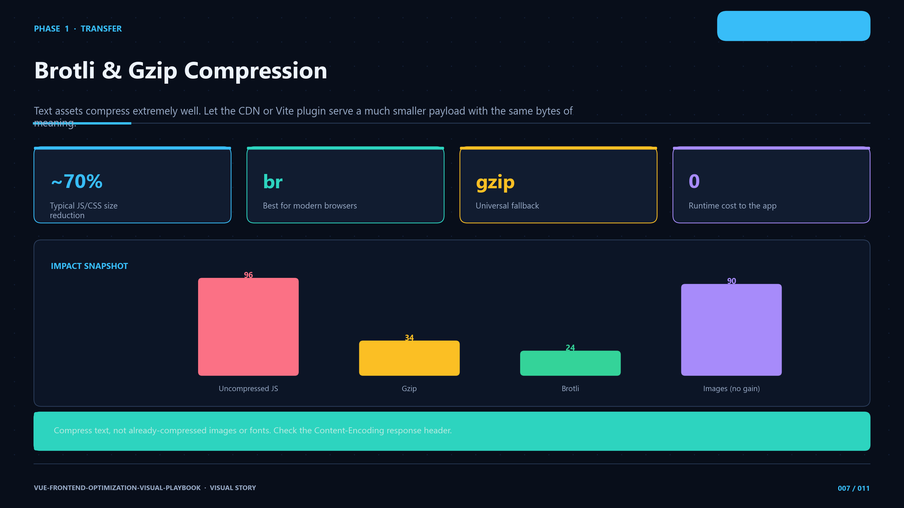

**The idea.** Text assets compress extremely well. Let the CDN or Vite plugin serve a much smaller payload with the same bytes of meaning.

**Why it matters.** Compression is the cheapest speed win available: no code changes, no risk, large transfer savings.

**Prompt.**

```text
Add vite-plugin-compression for Brotli/Gzip and verify Content-Encoding: br on the built assets.
```

### 08 · Preload Critical Assets

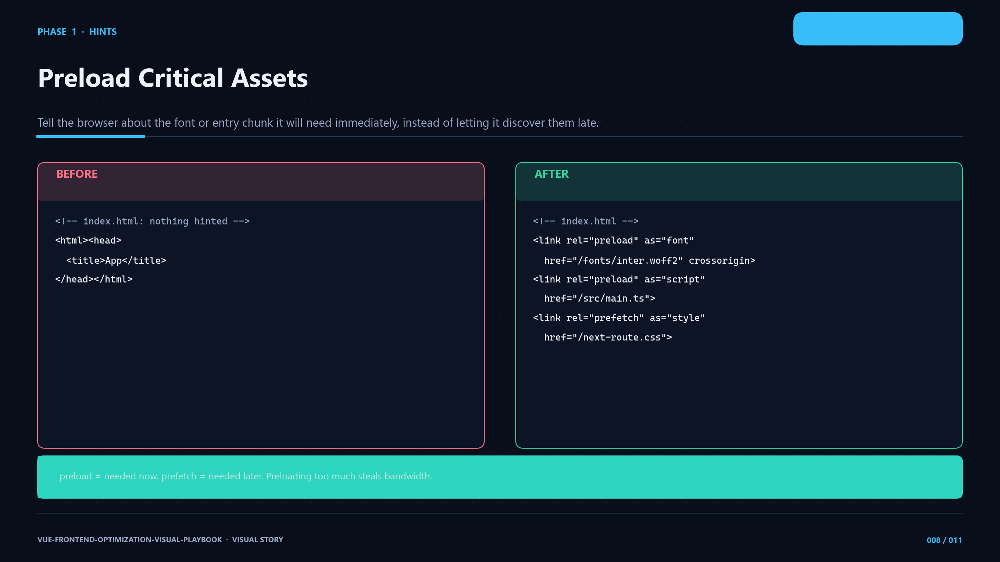

**The idea.** Tell the browser about the font or entry chunk it will need immediately, instead of letting it discover them late.

**Why it matters.** Preloading fixes discovery delay, not download size. Use it for the one or two assets on the critical path.

**Prompt.**

```text
Add <link rel="preload"> for critical above-the-fold fonts and entry assets in index.html.
```

### 09 · Vite Bundle Analyzer


**The idea.** A picture of the build output turns 'the bundle feels big' into 'this library is 480 KB'.

**Why it matters.** The analyzer is the measuring instrument for this entire phase. It tells you which lever is worth pulling.

**Prompt.**

```text
Add rollup-plugin-visualizer configured to emit stats.html, then run npm run build and inspect the largest chunk.
```

### 10 · Web Workers: Off the Main Thread

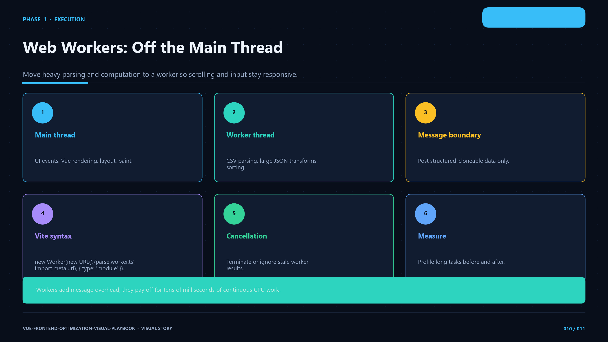

**The idea.** Move heavy parsing and computation to a worker so scrolling and input stay responsive.

**Why it matters.** A 300 ms parse on the main thread is a 300 ms freeze. In a worker it is invisible to the user.

**Prompt.**

```text
Move this heavy parse/filter into a Vite module worker and post the result back as a plain object.
```

### 11 · Bundle Budgets as a Guardrail

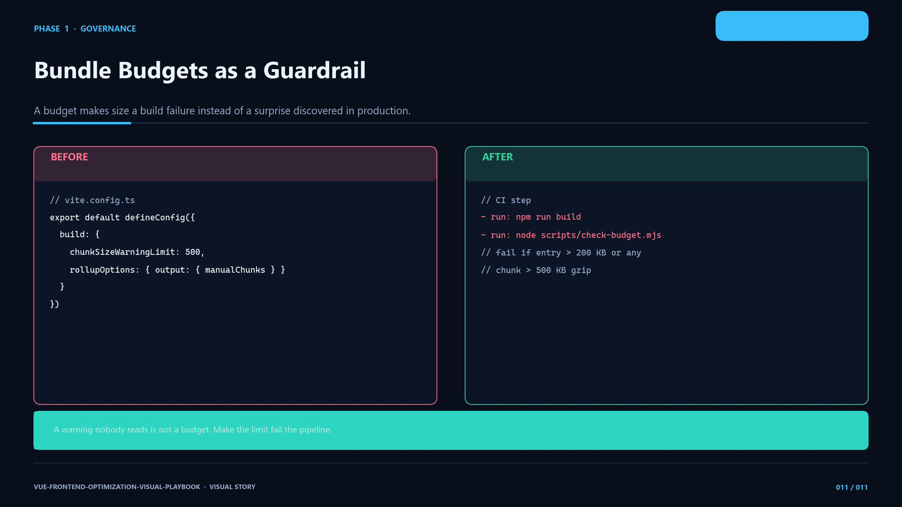

**The idea.** A budget makes size a build failure instead of a surprise discovered in production.

**Why it matters.** Budgets stop regression by one dependency at a time — exactly how bloat actually arrives.

**Prompt.**

```text
Set build.chunkSizeWarningLimit and add a CI step that fails when the entry or vendor chunk exceeds the budget.
```

---

## <a id="22-optimization-phase-2--heavy-component--list-rendering"></a>2.2 Optimization Phase 2 — Heavy Component & List Rendering

Phase 2 targets the DOM and the frame budget. Scope the prompt to src/views, src/pages and complex feature components; skip small UI primitives like buttons and inputs.

### 01 · Phase 2 Overview: Heavy Component & List Rendering


**The idea.** Five levers keep the DOM small and the renderer idle: async components, KeepAlive, virtualization, v-once and v-memo.

**Why it matters.** Rendering work is bounded by the number of nodes and how often they are touched. This phase shrinks both numbers.

**Prompt.**

```text
Identify the heaviest views, modals and large lists in src/views and src/components. Skip small UI primitives.
```

### 02 · defineAsyncComponent for Heavy Widgets

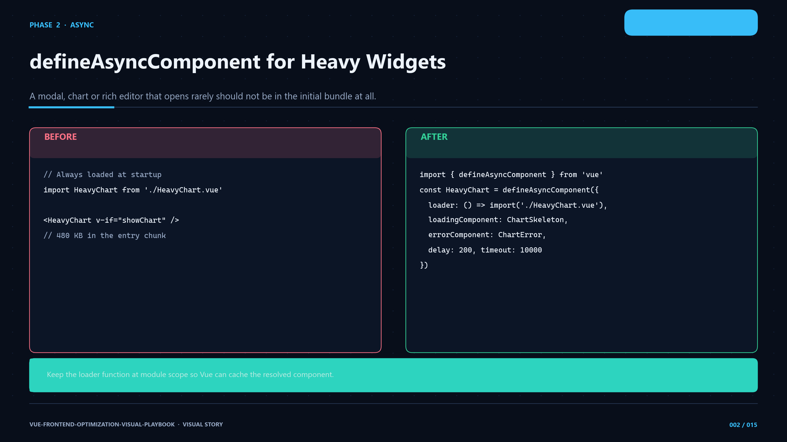

**The idea.** A modal, chart or rich editor that opens rarely should not be in the initial bundle at all.

**Why it matters.** Async components convert a permanent download cost into a one-time cost paid only by users who open the feature.

**Prompt.**

```text
Wrap each heavy conditional modal, drawer, editor and chart with defineAsyncComponent and a skeleton fallback.
```

### 03 · KeepAlive for Stateful Views


**The idea.** When users switch tabs often, unmounting and rebuilding the view wastes work and loses scroll/filter state.

**Why it matters.** KeepAlive trades a bounded amount of memory for instant tab switching and preserved state — a good deal for navigation.

**Prompt.**

```text
Wrap dynamic tab/route views in <KeepAlive :max="5"> and pause timers in onDeactivated.
```

### 04 · Virtual Scrolling Implementation

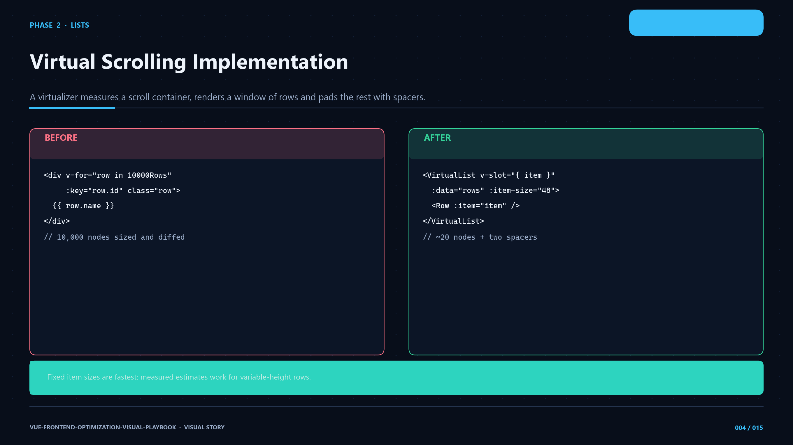

**The idea.** A virtualizer measures a scroll container, renders a window of rows and pads the rest with spacers.

**Why it matters.** The virtualizer keeps DOM size constant, so scrolling a million rows costs the same as scrolling one hundred.

**Prompt.**

```text
Replace this 100+ item v-for with @tanstack/vue-virtual using a fixed row height where possible.
```

### 05 · v-once: Render Once, Skip Forever


**The idea.** Static blocks never need a diff. v-once tells Vue to render them once and skip future updates entirely.

**Why it matters.** v-once is the cheapest memoization: no dependencies to track, no comparisons to make.

**Prompt.**

```text
Add v-once to template blocks whose content never changes after the first render, then verify with Devtools.
```

### 06 · v-memo: Cache an Expensive Subtree

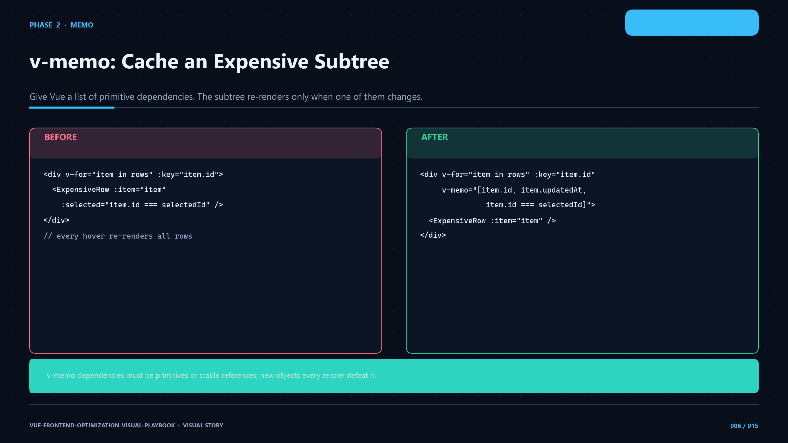

**The idea.** Give Vue a list of primitive dependencies. The subtree re-renders only when one of them changes.

**Why it matters.** v-memo is surgical: it avoids diff work for rows whose visible inputs did not change.

**Prompt.**

```text
Add v-memo="[...]" to expensive v-for items using only primitive keys such as item.id and item.selected.
```

### 07 · Layout Thrashing Prevention

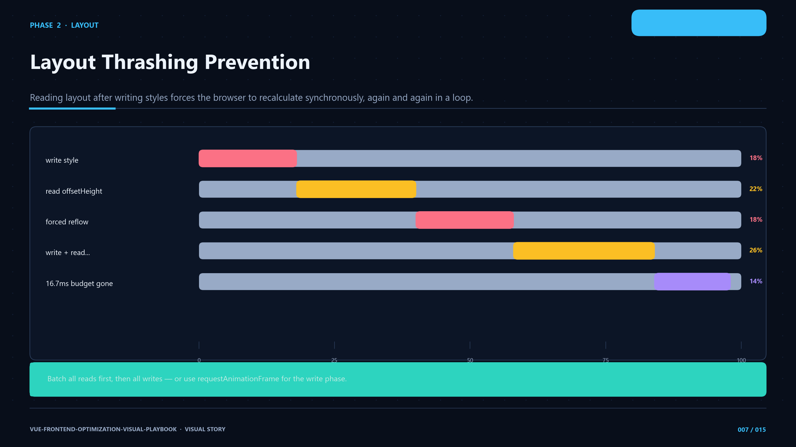

**The idea.** Reading layout after writing styles forces the browser to recalculate synchronously, again and again in a loop.

**Why it matters.** Alternating reads and writes inside a loop turns one layout pass into N synchronous passes.

**Prompt.**

```text
Batch layout reads before writes in this loop and move style writes into a requestAnimationFrame callback.
```

### 08 · Reflow Elimination


**The idea.** Some properties only repaint; others invalidate layout for the whole subtree. Prefer the cheaper ones.

**Why it matters.** A reflow recalculates positions for descendants. Compositor-only properties skip that work entirely.

**Prompt.**

```text
Change this animation from width/top to transform and verify in Devtools Rendering paint flashing.
```

### 09 · GPU Compositing: transform & opacity

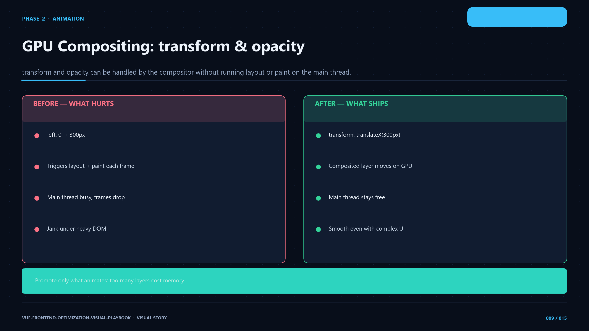

**The idea.** transform and opacity can be handled by the compositor without running layout or paint on the main thread.

**Why it matters.** The compositor is a separate thread that can move pre-painted layers. Feed it properties it understands.

**Prompt.**

```text
Replace these position/size animations with transform and opacity, then record a Performance trace.
```

### 10 · The 16.7ms Frame Budget

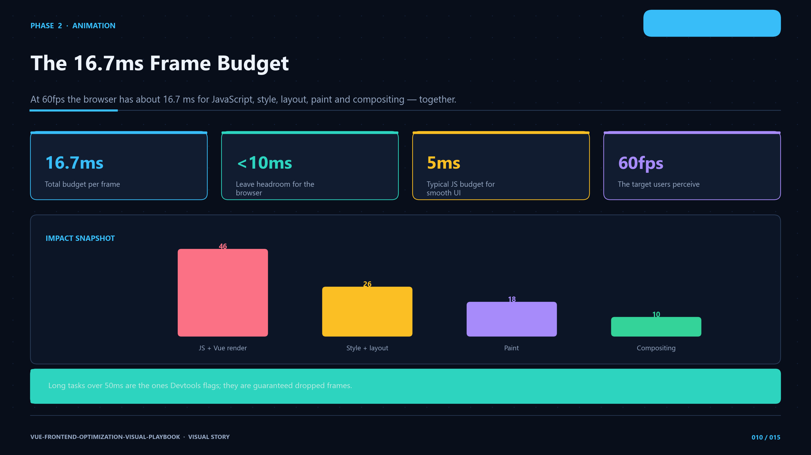

**The idea.** At 60fps the browser has about 16.7 ms for JavaScript, style, layout, paint and compositing — together.

**Why it matters.** Smoothness is a budget, not a feeling. Measure a frame trace and keep your JavaScript share small.

**Prompt.**

```text
Record a Performance trace of this interaction and reduce the longest task to under 10ms.
```

### 11 · Hardware Acceleration


**The idea.** Browsers promote selected elements to GPU layers. The trick is choosing the few elements that benefit.

**Why it matters.** Too many promoted layers make things worse. Promote during motion, then remove the hint.

**Prompt.**

```text
Apply will-change: transform only to the animating element and remove it after transitionend.
```

### 12 · CSS Containment: contain: content

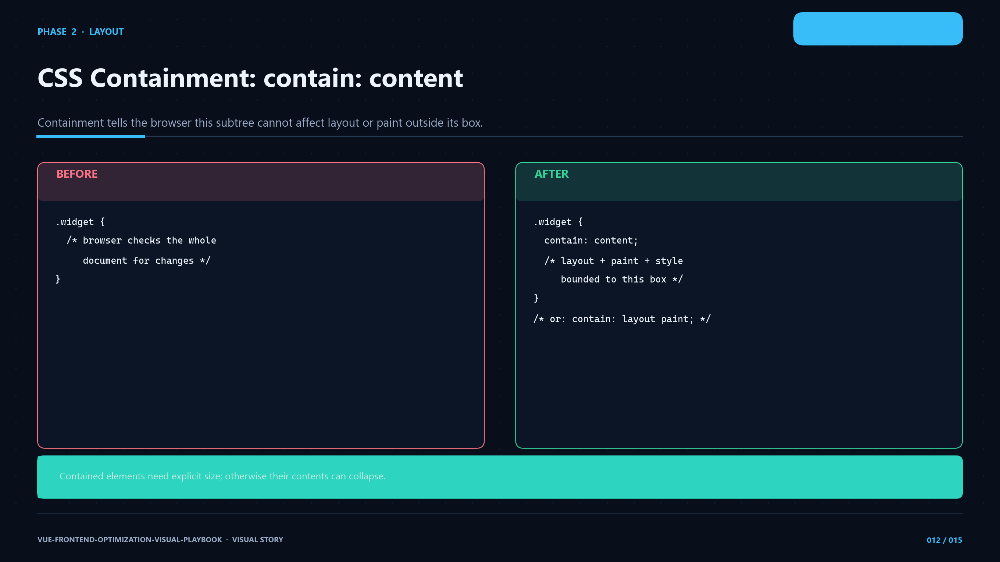

**The idea.** Containment tells the browser this subtree cannot affect layout or paint outside its box.

**Why it matters.** In large dashboards, containment reduces the scope of invalidation from the page to one widget.

**Prompt.**

```text
Add contain: content to independent dashboard widgets that have explicit dimensions.
```

### 13 · Skeleton Screens

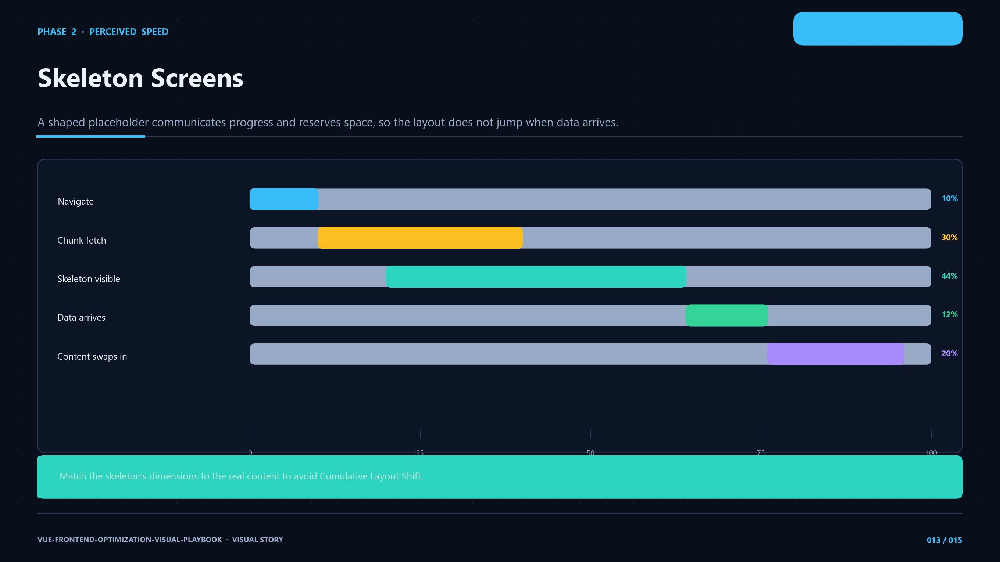

**The idea.** A shaped placeholder communicates progress and reserves space, so the layout does not jump when data arrives.

**Why it matters.** Skeletons do not make data faster; they make waiting legible and prevent layout jumps.

**Prompt.**

```text
Add a skeleton loadingComponent to this async view with the same dimensions as the final content.
```

### 14 · Progressive Hydration

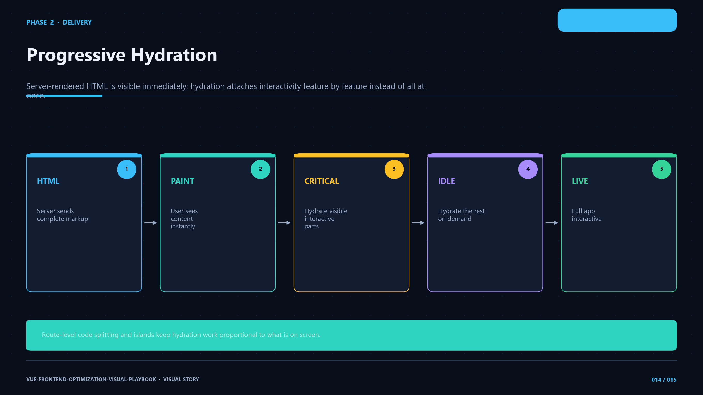

**The idea.** Server-rendered HTML is visible immediately; hydration attaches interactivity feature by feature instead of all at once.

**Why it matters.** Full-app hydration can block the main thread even when the page already looks ready. Progressive hydration spreads the cost.

**Prompt.**

```text
Evaluate hydrating only this page's interactive islands first; defer below-the-fold widgets to idle time.
```

### 15 · Profile Renders Before Guessing

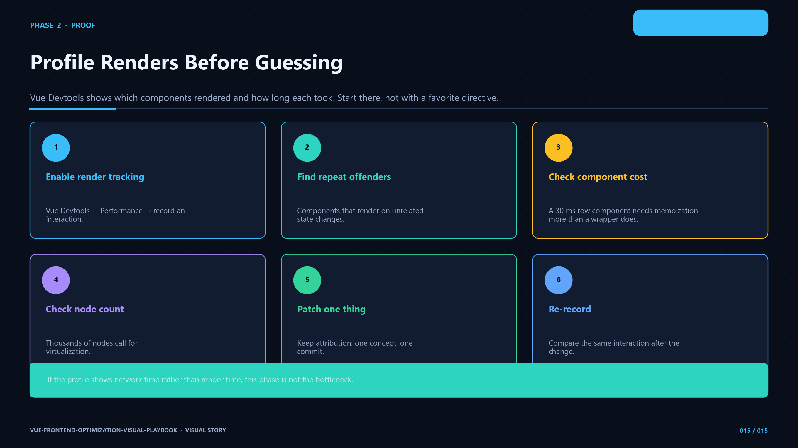

**The idea.** Vue Devtools shows which components rendered and how long each took. Start there, not with a favorite directive.

**Why it matters.** Measurement prevents cargo-cult optimization: v-once on a fast block changes nothing, while virtualizing a list changes everything.

**Prompt.**

```text
Record one interaction in Vue Devtools, name the most expensive component, and apply one targeted fix.
```

---

## <a id="23-optimization-phase-3--reactivity--events"></a>2.3 Optimization Phase 3 — Reactivity & Events

Phase 3 works inside <script setup>, composables and Pinia stores. The rule: track only what you render, compute instead of copying, and cancel anything that outlives a component.

### 01 · Phase 3 Overview: Reactivity & Events

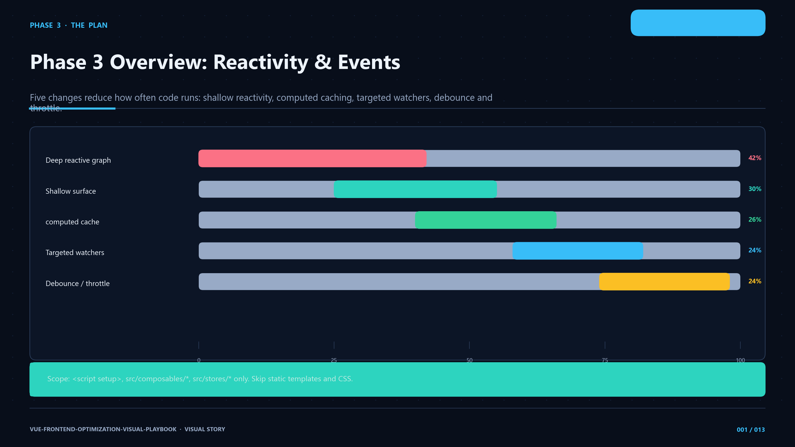

**The idea.** Five changes reduce how often code runs: shallow reactivity, computed caching, targeted watchers, debounce and throttle.

**Why it matters.** Reactivity is invisible until it is excessive. This phase narrows dependencies and controls event frequency.

**Prompt.**

```text
Audit <script setup> blocks and Pinia stores in src/stores/* for reactivity and event bottlenecks only.
```

### 02 · shallowRef for Large or External Objects


**The idea.** shallowRef tracks only .value replacement. Perfect for big API arrays and third-party instances.

**Why it matters.** Deep proxies cost memory and tracking time. If you always replace the whole object, shallowRef is strictly cheaper.

**Prompt.**

```text
Replace ref/reactive with shallowRef for large read-only API arrays and third-party instances, using .value reassignment.
```

### 03 · shallowReactive for Flat Shapes


**The idea.** Make only root-level properties reactive when nested objects are treated as opaque values.

**Why it matters.** shallowReactive keeps the familiar object API while avoiding deep proxy conversion on large nested data.

**Prompt.**

```text
Convert this large reactive object to shallowReactive and replace nested objects instead of mutating them.
```

### 04 · computed Caching Over Template Calls


**The idea.** A method call in a template runs on every render. A computed runs only when its dependencies change.

**Why it matters.** Moving work out of the template turns 'run every render' into 'run when inputs change'.

**Prompt.**

```text
Replace expensive function calls in this template with computed properties and verify caching in a test.
```

### 05 · Replace Deep Watchers With Targeted Getters


**The idea.** deep: true walks the whole nested tree on every change. Watch the exact field you actually care about.

**Why it matters.** A deep watcher on a large object is both broad and expensive. Targeted getters make intent obvious.

**Prompt.**

```text
Replace watch(..., { deep: true }) in this file with getters for the specific nested properties.
```

### 06 · Debounce Search Inputs


**The idea.** One request after the user stops typing beats seven requests for seven keystrokes.

**Why it matters.** Debouncing reduces network load and render churn while preserving the feeling of instant feedback in the input itself.

**Prompt.**

```text
Add a 300ms debounce to this search/filter handler and cancel it when the component unmounts.
```

### 07 · Throttle Scroll & Resize Handlers


**The idea.** Native scroll and resize fire far faster than a frame. Throttle to one callback per animation frame.

**Why it matters.** Throttling keeps visual feedback smooth without saturating the main thread with redundant work.

**Prompt.**

```text
Throttle this scroll/resize handler to one call per frame and remove the listener on unmount.
```

### 08 · Fixing Async Race Conditions


**The idea.** When a newer request starts, cancel the older one — or tag results so stale answers can be discarded.

**Why it matters.** A stale response overwriting a fresh one looks like a random bug. Cancellation makes ordering deterministic.

**Prompt.**

```text
Add AbortController to this watcher-driven fetch and abort the previous request before starting the next.
```

### 09 · Idempotent Actions & Retries


**The idea.** A retried mutation must not create a second order. Pair a client lock with a server-side key.

**Why it matters.** Client-side guards reduce accidents; only a server-side key makes retries genuinely safe.

**Prompt.**

```text
Add a pending guard and an idempotency key to this mutation before enabling automatic retries.
```

### 10 · Fixing Reactivity Leaks


**The idea.** A memoized child that never updates usually means a shallow reference was mutated instead of replaced.

**Why it matters.** Switching to shallowRef without switching to immutable updates is the most common cause of 'broken reactivity' reports.

**Prompt.**

```text
Audit shallowRef usages for in-place mutation and convert each to a top-level reassignment.
```

### 11 · Watcher Cleanup & stopHandle


**The idea.** Watchers created inside effects can outlive the scope that made them. Keep them tied to a scope or stop them explicitly.

**Why it matters.** Cleanup hooks are part of the watcher, not an optional courtesy — they prevent duplicated side effects over time.

**Prompt.**

```text
Register onCleanup and onScopeDispose for every watcher in this composable that subscribes to an external source.
```

### 12 · Fixing Memory Leaks


**The idea.** After repeated navigation, heap size should return to baseline. If it grows, something still holds a reference.

**Why it matters.** Leaks rarely show up in tests; they show up after a user has been in the app for an hour.

**Prompt.**

```text
Add teardown for every listener/timer in this component and verify the heap across three mount cycles.
```

### 13 · Fixing Template Bloat


**The idea.** When every row has inline expressions and deeply nested branches, even small state changes re-render the whole area.

**Why it matters.** Template expressions execute in the render context. Removing them reduces per-render allocations and diff complexity.

**Prompt.**

```text
Move the formatting calls in this template into a computed map and memoize the rows on primitive keys.
```

---

## <a id="24-optimization-phase-4--media--rendering-architecture"></a>2.4 Optimization Phase 4 — Media & Rendering Architecture

Phase 4 is the last optimization phase. Inspect image usage, public/ assets and package.json — evaluate SSR/SSG in writing, but never migrate a framework automatically.

### 01 · Phase 4 Overview: Media & Rendering Architecture


**The idea.** Images usually dominate payload, while SSR/SSG decisions dominate First Contentful Paint and SEO.

**Why it matters.** This phase changes bytes and architecture, not state. Keep it separate from reactivity work to avoid confusion.

**Prompt.**

```text
Scan templates and public/ / src/assets/ for image usage and check whether this project requires SSR/SSG.
```

### 02 · Image Optimization Checklist


**The idea.** Resizing, compressing and lazy-loading images usually removes more bytes than every JavaScript tweak combined.

**Why it matters.** Images are often 60-80% of transferred bytes. A single unoptimized hero can outweigh the entire app bundle.

**Prompt.**

```text
Audit oversized images in public/ and src/assets/, then resize and convert them to WebP/AVIF with fallbacks.
```

### 03 · WebP & AVIF Formats


**The idea.** Modern codecs deliver the same visual quality at much smaller sizes than JPEG/PNG.

**Why it matters.** Format conversion is a pure payload win with no behavioural risk, so it belongs early in the media phase.

**Prompt.**

```text
Update this image reference to prefer .avif/.webp with a JPEG fallback, or add vite-imagetools to the build.
```

### 04 · Lazy-Load Below-the-Fold Images


**The idea.** Browsers can defer off-screen images natively — no JavaScript observer needed for most cases.

**Why it matters.** Native lazy loading removes off-screen network pressure from the critical path with one attribute.

**Prompt.**

```text
Add loading="lazy", decoding="async" and explicit width/height to every below-the-fold  tag.
```

### 05 · Explicit Dimensions Prevent CLS


**The idea.** Without width and height, the browser cannot reserve space. Late images push content down and cause layout shift.

**Why it matters.** Cumulative Layout Shift is a Core Web Vital and a trust problem: users click the wrong thing when content moves.

**Prompt.**

```text
Add width and height (or aspect-ratio) to every image that lacks them and measure CLS again.
```

### 06 · fetchpriority for the Hero Image


**The idea.** Not all images are equal. Tell the browser which one is the LCP element so it stops competing with below-the-fold assets.

**Why it matters.** Priority hints make the browser's download queue match your product's visual hierarchy.

**Prompt.**

```text
Mark the hero/LCP image eager with fetchpriority="high" and keep all gallery images lazy.
```

### 07 · SSR: HTML on the First Response


**The idea.** Server-side rendering sends meaningful HTML immediately, so users and crawlers see content before JavaScript runs.

**Why it matters.** SSR is a trade: faster first paint and crawlability in exchange for infrastructure and hydration work.

**Prompt.**

```text
Assess this route's SEO/FCP needs and list the server requirements before considering an SSR migration.
```

### 08 · SSG: Render Once at Build Time


**The idea.** For content that rarely changes, pre-render at build time and serve static HTML from a CDN.

**Why it matters.** SSG gives SSR-like first paint with none of the per-request rendering cost, as long as content is build-time data.

**Prompt.**

```text
Identify statically known routes here and recommend prerendering them instead of full SSR.
```

### 09 · SPA, SSR or SSG? A Decision Tree


**The idea.** The answer depends on SEO needs, data freshness and team capacity — not on what is fashionable.

**Why it matters.** Framework migrations are expensive. Most authenticated products get more from a well-split SPA than from SSR.

**Prompt.**

```text
Write a 3-4 bullet SPA vs SSR/SSG recommendation for this repo based on its routing and data fetching.
```

### 10 · Prerendering Without a Framework Migration


**The idea.** vite-ssg or vite-plugin-ssr can generate static HTML for selected routes while keeping the Vite SPA you already have.

**Why it matters.** Incremental prerendering is the middle path: improve public-page SEO without rewriting the app around Nuxt.

**Prompt.**

```text
Evaluate vite-ssg for this project's public routes and keep authenticated routes client-rendered.
```

### 11 · Prefetch on Intent


**The idea.** Fetch the next route while the user is still hovering or reading. Latency disappears before the click happens.

**Why it matters.** Prefetching moves work into idle time. It is the last mile that makes lazy routes feel local.

**Prompt.**

```text
Prefetch this next-likely route on hover/focus using requestIdleCallback or the router's prefetch hook.
```

---

## <a id="31-scaling-phase-1--architecture--state"></a>3.1 Scaling Phase 1 — Architecture & State

Phase 1 of scaling breaks monolithic folders into isolated, domain-driven modules so several developers can work without merge conflicts or tight coupling.

### 01 · Scaling Phase 1 Overview: Architecture & State


**The idea.** Feature folders, composables, small stores and strict types turn one big app into independent, testable domains.

**Why it matters.** Scaling is organizational before it is technical. The folder structure decides who can change what safely.

**Prompt.**

```text
Refactor folder structure by feature/domain, extract use* composables, split Pinia stores and enable strict: true.
```

### 02 · Feature-Sliced Design in Practice


**The idea.** FSD orders layers so code only imports downward: app → pages → features → entities → shared.

**Why it matters.** Layered dependencies make it obvious where a piece of code belongs and prevent circular imports by construction.

**Prompt.**

```text
Map the current folders to these layers and move one feature into src/features/<domain>/ with a public index.ts.
```

### 03 · Domain Feature Folders


**The idea.** A feature folder owns its view, composable, API calls and types. Everything else imports its public index.

**Why it matters.** Colocation makes the blast radius of a change visible and removes cross-team merge conflicts.

**Prompt.**

```text
Move this feature's view, logic, API and types into one folder and expose only index.ts to the rest of the app.
```

### 04 · Extract use<Feature> Composables


**The idea.** A composable is a named unit of stateful logic you can test without mounting the DOM.

**Why it matters.** Composables turn component logic into reusable, unit-testable modules while keeping the view declarative.

**Prompt.**

```text
Extract stateful logic from this large .vue file into use<Feature>.ts and keep markup and bindings in the view.
```

### 05 · Split Monolithic Pinia Stores


**The idea.** One store per domain with Setup Store syntax keeps state, getters and actions together and independently testable.

**Why it matters.** A single global store becomes a hidden dependency graph. Small stores make ownership and testing straightforward.

**Prompt.**

```text
Split this monolithic store into single-responsibility Setup Stores and update feature imports to the new modules.
```

### 06 · Strict TypeScript at Scale


**The idea.** At scale, implicit any is a tax on every consumer. Strict types on stores and composables pay for themselves.

**Why it matters.** Types are the interface between teams. Strictness makes a feature's contract visible before runtime.

**Prompt.**

```text
Enable strict: true in tsconfig*.json and resolve implicit any in stores and composables first.
```

### 07 · Migrate Folders Without Stopping the Product


**The idea.** A big-bang restructure breaks everything. Move one domain at a time behind a stable public index.

**Why it matters.** Migration risk is proportional to batch size. One domain per commit keeps the app shippable throughout.

**Prompt.**

```text
Plan this folder migration as one domain per commit with vue-tsc and tests between each step.
```

---

## <a id="32-scaling-phase-2--data-layer--resilience"></a>3.2 Scaling Phase 2 — Data Layer & Resilience

Phase 2 moves HTTP out of components, adds a caching layer for server state, offloads heavy compute and contains failures with error boundaries.

### 01 · Scaling Phase 2 Overview: Data Layer & Resilience


**The idea.** Typed services, query caching, workers and error boundaries make the app resilient under real network and data loads.

**Why it matters.** At scale, data bugs are usually about ownership: who caches, who retries, who handles failure. This phase assigns each.

**Prompt.**

```text
Centralize fetch calls in typed services, introduce Vue Query, offload heavy transforms and wrap features in error boundaries.
```

### 02 · Repository / Service Layer


**The idea.** Components ask for domain data; a typed service knows the URL, mapping and error semantics.

**Why it matters.** Centralized services make caching, auth headers and retries possible in one place instead of twenty components.

**Prompt.**

```text
Move raw fetch/axios calls out of .vue files into typed src/services/<domain>.service.ts modules.
```

### 03 · Shared HTTP Interceptors


**The idea.** Auth headers, CSRF tokens, error normalization and 401 refresh belong in the client, not in every call site.

**Why it matters.** Interceptors enforce consistent transport behaviour, which is especially important for security and observability.

**Prompt.**

```text
Add shared request/response interceptors for credentials, CSRF headers and normalized errors in this HTTP client.
```

### 04 · TanStack Query for Server State


**The idea.** Server state has different needs from UI state: caching, deduplication, refetch on focus and stale time.

**Why it matters.** Vue Query removes an entire category of loading, caching and invalidation code from components.

**Prompt.**

```text
Introduce @tanstack/vue-query for this endpoint with a stable query key and a documented staleTime.
```

### 05 · Request Deduplication


**The idea.** Five components asking for the same key should cause one network request, not five.

**Why it matters.** Dedup reduces server load and avoids flicker when several views mount at once.

**Prompt.**

```text
Replace manual request guards here with a query key that all consumers share, and verify one network call.
```

### 06 · Background Refetching


**The idea.** Keep showing cached data while a fresh request runs. Use refetchOnWindowFocus and refetchInterval deliberately.

**Why it matters.** Background refetching makes data fresh without making the UI blank — the same idea as stale-while-revalidate.

**Prompt.**

```text
Configure staleTime and refetchOnWindowFocus for this query and keep cached data visible during refresh.
```

### 07 · Offload Heavy Data Transforms


**The idea.** Large CSV parsing or filtering belongs in a worker so the UI thread never freezes.

**Why it matters.** Workers turn a main-thread freeze into a background task with a progress indicator.

**Prompt.**

```text
Move this heavy parse/filter into a Vite worker, transfer the buffer and render progress from worker messages.
```

### 08 · Error Boundaries at Feature Roots


**The idea.** Wrap each major feature view so one widget's render error cannot blank the whole app.

**Why it matters.** Boundaries turn total failures into local, recoverable ones — a requirement for large apps with many teams.

**Prompt.**

```text
Wrap each major feature view in a reusable ErrorBoundary using onErrorCaptured with a retry fallback.
```

---

## <a id="33-scaling-phase-3--governance--delivery"></a>3.3 Scaling Phase 3 — Governance & Delivery

Phase 3 standardizes UI across teams, enforces security and performance guardrails in CI, and adds production visibility so regressions are caught before users report them.

### 01 · Scaling Phase 3 Overview: Governance & Delivery


**The idea.** Design tokens, RBAC, budgets, CI checks and observability turn good intentions into automated guardrails.

**Why it matters.** Governance is what makes the first two pillars survive the next ten developers and the next ten releases.

**Prompt.**

```text
Consolidate design tokens, add meta-driven RBAC, set bundle budgets, run CI checks and add observability hooks.
```

### 02 · Design Tokens in CSS Custom Properties


**The idea.** One source for color, spacing and typography keeps every team's UI consistent and themes cheap.

**Why it matters.** Tokens remove visual drift and make dark mode or rebranding a variable swap instead of a repository-wide edit.

**Prompt.**

```text
Replace hardcoded colors, spacing and radii in this UI folder with CSS custom property design tokens.
```

### 03 · Shared Component Library


**The idea.** A small set of well-documented primitives with stable props and slots beats every team rebuilding a button.

**Why it matters.** Shared UI raises the floor of quality across teams and reduces accessibility work to one implementation.

**Prompt.**

```text
Consolidate duplicated buttons/inputs into src/shared/ui with typed props, slots and an index.ts export.
```

### 04 · Meta-Driven RBAC Route Guards


**The idea.** Permissions live on route meta and are enforced in router.beforeEach before a view ever mounts.

**Why it matters.** Route-level permissions make access control declarative, reviewable and impossible to skip by deep-linking.

**Prompt.**

```text
Add declarative role/permission meta to these routes and enforce it in router.beforeEach before mounting.
```

### 05 · CI Gates: vue-tsc, Vitest, Playwright


**The idea.** Automated checks are the only guardrail that runs when nobody is watching.

**Why it matters.** CI turns conventions into enforcement. A pipeline with clear, fast failures keeps quality from depending on discipline.

**Prompt.**

```text
Ensure CI runs vue-tsc, Vitest and Playwright plus the production build before any deploy.
```

### 06 · Observability: Error & Performance Hooks


**The idea.** Production feedback closes the loop: errors and long tasks should reach your dashboard, not the support inbox.

**Why it matters.** You cannot optimize or secure what you cannot see. Hooks make production behaviour measurable.

**Prompt.**

```text
Register app.config.errorHandler and Web Vitals reporting in src/main.ts with token/PII redaction.
```

### 07 · Micro-Frontends: Decide With Data


**The idea.** Module Federation solves independent deployment across teams. It also adds runtime and operational complexity.

**Why it matters.** Federation is a last resort in the scaling roadmap. Start with module boundaries; escalate only when deployment ownership demands it.

**Prompt.**

```text
Evaluate team size and deployment needs, then write a short recommendation on Module Federation for this repo.
```

---

## <a id="41-security-phase-1--xss-injection--storage"></a>4.1 Security Phase 1 — XSS, Injection & Storage

Phase 1 removes client-side injection vectors and stops secrets or tokens from leaking through storage, logs and bundled environment variables.

### 01 · Security Phase 1 Overview: XSS & Storage


**The idea.** Sanitize at render boundaries, validate at input boundaries, and keep sensitive values out of the browser entirely.

**Why it matters.** Most frontend security incidents start with untrusted text becoming executable code, or a secret becoming public.

**Prompt.**

```text
Audit every v-html and dynamic :href, validate forms, scrub VITE_* secrets and remove tokens from storage and logs.
```

### 02 · XSS Prevention Basics


**The idea.** Vue escapes text by default. XSS appears when you opt out with v-html, dynamic attributes or raw DOM APIs.

**Why it matters.** The attacker's input is data, never code. Keep it that way unless you have explicitly made it safe.

**Prompt.**

```text
Find every v-html, innerHTML and dynamic :href in this component and classify it as sanitized or remove it.
```

### 03 · Sanitize v-html With DOMPurify


**The idea.** If you must render HTML, pass it through a battle-tested sanitizer before Vue inserts it.

**Why it matters.** DOMPurify removes scripts, event handlers and javascript: URLs while preserving the formatting you intended.

**Prompt.**

```text
Wrap this v-html binding in DOMPurify.sanitize with an explicit allowlist and add a regression test with an XSS payload.
```

### 04 · Block javascript: URIs in Dynamic Links


**The idea.** A dynamic :href can execute script when the value starts with javascript:. Allowlist safe protocols instead.

**Why it matters.** Protocol validation is a small helper that closes a surprising number of injection paths.

**Prompt.**

```text
Add a safeUrl() helper to this component's dynamic :href bindings and test it with a javascript: payload.
```

### 05 · Schema Validation on User Forms


**The idea.** Validate shape, length and type at the boundary with Zod or VeeValidate; never trust client values or API DTOs.

**Why it matters.** A schema gives you a typed, validated value instead of an object full of assumptions.

**Prompt.**

```text
Add a Zod schema to this form and submit only the parsed result, with inline errors for invalid fields.
```

### 06 · Environment Variable Hygiene


**The idea.** Everything named VITE_* is embedded in the client bundle. Secrets must never live there.

**Why it matters.** There is no such thing as a private client-side environment variable. Move secrets behind a server endpoint.

**Prompt.**

```text
Inspect .env* and import.meta.env.VITE_* usages here and remove any private key, token or database credential.
```

### 07 · Redact Secrets in Logs & Errors


**The idea.** console.log and error trackers often capture the whole request object — including tokens and PII.

**Why it matters.** Logs are copied into tickets, dashboards and third-party tools; treat them as public storage.

**Prompt.**

```text
Add a redaction helper to this logger/error reporter and remove token or PII dumps from console.log calls.
```

### 08 · Storage Hygiene


**The idea.** localStorage is readable by any script on the origin. Keep raw JWTs, passwords and PII out of it.

**Why it matters.** Storage hygiene limits the blast radius of XSS and reduces privacy exposure on shared devices.

**Prompt.**

```text
Remove raw tokens and PII from localStorage/sessionStorage in this feature and clear remaining keys on logout.
```

---

## <a id="42-security-phase-2--auth-headers--supply-chain"></a>4.2 Security Phase 2 — Auth, Headers & Supply Chain

Phase 2 locks down authentication flows, browser security headers, route access control and third-party dependencies.

### 01 · Security Phase 2 Overview: Auth & Headers


**The idea.** Cookies, CSRF, RBAC, CSP and transport headers work together: no single one is sufficient.

**Why it matters.** Security is defense in depth. Each layer assumes another one fails, so a single mistake is not a full compromise.

**Prompt.**

```text
Harden cookie auth, CSRF, RBAC guards, CSP/frame-ancestors/HSTS, SRI, abuse controls and run npm audit.
```

### 02 · HttpOnly Cookies for Sessions


**The idea.** The browser sends the cookie automatically and JavaScript cannot read it — XSS no longer steals the session directly.

**Why it matters.** HttpOnly removes the most valuable target from client-side script. It is the foundation of modern browser auth.

**Prompt.**

```text
Configure the HTTP client with withCredentials: true and move token storage to an HttpOnly; Secure cookie.
```

### 03 · Secure & SameSite Cookie Flags


**The idea.** Secure blocks plain HTTP transmission; SameSite limits when the browser sends the cookie on cross-site requests.

**Why it matters.** Cookie attributes are server configuration, not client code. Verify them in the browser's Application tab.

**Prompt.**

```text
Set HttpOnly, Secure and SameSite on the session cookie and verify the attributes in DevTools.
```

### 04 · Safe 401 Refresh Rotation


**The idea.** When an access token expires, rotate the refresh token once, replay the original request, and stop on a second failure.

**Why it matters.** Naive refresh logic is a common source of retry storms and account lockouts. One refresh per failure is the rule.

**Prompt.**

```text
Implement single-flight 401 refresh with a retry limit and logout on the second failure in this HTTP client.
```

### 05 · CSRF Protection for State Changes


**The idea.** Ambient cookies ride along on cross-site requests. Require an extra token that an attacker's site cannot read.

**Why it matters.** CSRF tokens make the browser's automatic cookie behaviour safe for mutations.

**Prompt.**

```text
Attach the CSRF header on every state-mutating request and confirm the server validates it.
```

### 06 · RBAC Guards Before Mounting


**The idea.** Client-side guards improve UX; the server must still authorize every request. Never rely on hiding a button.

**Why it matters.** Route guards stop deep links to protected screens before they render and before their data requests fire.

**Prompt.**

```text
Verify this router's beforeEach blocks unauthenticated and unauthorized navigation before the protected view mounts.
```

### 07 · Content Security Policy


**The idea.** CSP tells the browser which script, style, image and connect sources are allowed. Inline scripts become a thing of the past.

**Why it matters.** CSP is the strongest browser-level defense against XSS and data exfiltration, but it needs careful rollout.

**Prompt.**

```text
Add a strict CSP header in the hosting config, starting in Report-Only mode, and remove unsafe-inline where possible.
```

### 08 · Clickjacking Protection


**The idea.** Frame-ancestors in CSP (and X-Frame-Options as a fallback) stops attackers embedding your app in a transparent iframe.

**Why it matters.** A one-line header removes an entire class of UI redressing attacks.

**Prompt.**

```text
Set frame-ancestors 'none' and X-Frame-Options: DENY in this app's hosting configuration.
```

### 09 · Subresource Integrity for CDN Tags


**The idea.** SRI makes the browser verify a hash before executing a third-party script. A compromised CDN cannot inject code.

**Why it matters.** SRI protects the supply chain at the point of use, especially for scripts loaded from outside your build.

**Prompt.**

```text
Add integrity and crossorigin attributes to every external script/style tag in index.html.
```

### 10 · HTTPS & HSTS


**The idea.** TLS protects data in transit; HSTS tells browsers to refuse plain HTTP for your domain in the future.

**Why it matters.** HSTS turns a one-time redirect into a lasting guarantee that browsers will not fall back to HTTP.

**Prompt.**

```text
Enforce HTTPS and add the HSTS header to this app's hosting config after verifying all subdomains.
```

### 11 · Abuse Controls on Auth Forms


**The idea.** Login, registration and password reset need throttling and bot checks to resist credential stuffing.

**Why it matters.** Auth endpoints are public by definition. Rate limits make brute force economically pointless.

**Prompt.**

```text
Add submit throttling and a CAPTCHA hook to these auth forms, plus server-side rate limits and 429 handling.
```

### 12 · Dependency Vulnerability Auditing


**The idea.** Your supply chain is code you did not write. Audit it in CI and upgrade high-severity advisories deliberately.

**Why it matters.** A vulnerable transitive dependency is a vulnerability in your app. Continuous auditing makes that manageable.

**Prompt.**

```text
Run npm audit --audit-level=high, report the advisories, and fix high-severity issues with tests re-run.
```

---

## <a id="5-proof--ship--verification-gates"></a>5. Proof & Ship — Verification Gates

The pipeline is only as strong as its gates. These three suites turn each pillar's claims into executable evidence, and the final summary is what you hand to a teammate, a manager, or a LinkedIn reader.

### 01 · Verification 1: /frontend-opt-tests


**The idea.** Prove that routes are lazy, heavy components load asynchronously, caching works and the production build is clean.

**Why it matters.** This suite protects the user-visible work from being silently undone by later refactors.

**Prompt.**

```text
Create Vitest tests in /frontend-opt-tests for lazy routes, async resolution, KeepAlive, computed caching, debounce and a clean build.
```

### 02 · Verification 2: /scaling-tests


**The idea.** Prove that services handle HTTP outcomes, state modules stay independent, and error boundaries contain crashes.

**Why it matters.** Scaling changes touch many files; these tests are what make the refactor reversible and reviewable.

**Prompt.**

```text
Create Vitest tests in /scaling-tests for service responses, deduplication, modular state and onErrorCaptured fallback UI.
```

### 03 · Verification 3: /security-tests


**The idea.** Prove that XSS payloads are stripped, guards block deep links, CSRF/credentials are attached and no secret leaks.

**Why it matters.** Security tests are regression locks: they stop a future convenience change from reopening a closed hole.

**Prompt.**

```text
Create Vitest regression tests in /security-tests for sanitization, RBAC redirects, CSRF, 401 refresh and storage/env hygiene, then run npm audit.
```

### 04 · The Executive Summary


**The idea.** One short report closes the pipeline: what changed, what passed, and what a human still must do.

**Why it matters.** The summary is the handover artifact. It turns a long refactor into three paragraphs a reviewer can trust.

**Prompt.**

```text
Write the executive summary with files modified per stage, all test results and the manual actions still required.
```

### 05 · Before / After Scorecard


**The idea.** Numbers make the story credible. Capture the same metrics before and after, on the same device and network settings.

**Why it matters.** Optimization without measurement is opinion. A two-column scorecard turns the entire pipeline into evidence.

**Prompt.**

```text
Record LCP, INP, CLS and bundle size before and after this phase under identical throttling, then commit the numbers.
```

### 06 · The Roadmap Checklist


**The idea.** Nine skills, three gates, one summary. This is the whole hardening pipeline on a single page.

**Why it matters.** The checklist is the contract: one skill per session, a test gate per pillar, and a written handover at the end.

**Prompt.**

```text
Follow the sequence 1-opt-1 → 1-opt-4 → 2-scale-1 → 2-scale-3 → 3-sec-1 → 3-sec-2 with a commit and a green suite between each step.
```

---

## <a id="verification-gates"></a>Verification Gates

A stage is finished when its suite is green. The three suites are described in detail in chapter 5:

1. `/frontend-opt-tests` — lazy routes, async resolution, KeepAlive, computed caching, debounce, clean build.
2. `/scaling-tests` — typed services, deduplication, modular state, error-boundary fallback.
3. `/security-tests` — sanitized XSS payloads, RBAC redirects, CSRF/credentials, storage and env hygiene, `npm audit`.

### Executive summary template

```markdown
## Executive Summary

1. **Files modified per stage**
   - Optimization: router, vite.config, views, composables, images
   - Scaling: features/, services/, stores/, main.ts, CI config
   - Security: sanitizers, guards, headers, env and storage cleanup
2. **Test results**: 100% pass in /frontend-opt-tests, /scaling-tests, /security-tests
3. **Manual actions**: rotate exposed keys, set HttpOnly/Secure cookies at the server,
   upgrade high-severity npm advisories, enable HSTS after HTTPS verification
4. **Measured impact**: before/after LCP, INP, CLS and gzip bundle size
```

---

## Final word

Performance work is not a pile of tricks. It is a loop: measure, locate, change one thing, verify, commit. The visuals in this repo exist to make each decision obvious enough to explain to a teammate in thirty seconds — and the prompts exist to make the change reproducible by any engineer on the team.

Source material: `guide.md` in this repository. Built with Python + matplotlib; all diagrams are generated, none are hand-edited.
